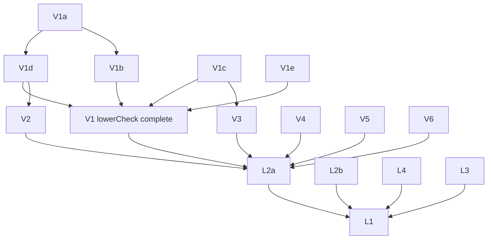

# What remains to be proven

Stock #140 now has a default selected entry-parameter-return class (i32/i64,
default/System V/fast) whose full normalized output equals legacy. The compiler
and all four E2E pipelines use this dispatcher while preserving old theorem
variants and input conditions. The broader rule/effect, source/block/whole-driver
simulation and Stock-only completeness obligations remain open. See the
[contract](contracts/stock-driver.md) and
[incremental delivery plan](plans/stock-driver-incremental-delivery.md).

Additive actual-output E2E contracts (`CompiledValidated`, cleanup variants and
`CompiledProduction`) compose source/SSA validation, concrete machine correctness
and world/non-interference without requiring legacy-constructor equality. Old
variants remain. Successful Stock and positive try-call/TLS witnesses cover both
cleanup modes. Additive whole-program/checker/binary consumers and an actual-result
byte-writer bridge now exist. Actual CLI/generated-proof/stack integration and the
next production class remain required; these contracts alone enable no new class.

The #60 cleanup implementation in #137 uses the legacy driver and preserves
baseline source scope and theorem variants. Cleanup and matching consumers are
enabled by default. Full proof/crate builds, runtime, encoder and E2E identity
parity pass; paired theorem audits have unchanged baseline axiom sets. Stock
artifact agreement improves 465 -> 671 (+206, zero losses); both E2E modes accept
the same 1,150 identities. Replacement-driver #135 remains paused. See
[the contract](contracts/dead-cleanup.md) and
[the implementation plan](plans/legacy-dead-instruction-cleanup.md).

Goal: **the compiler itself is formally verified.** Its correctness is one set of theorems proven once, for
every input program, with no per-program certificates: no validator verdict as a theorem premise, no
per-crate `native_decide` proof files, no external tool whose output must be checked for the result to be
correct. This file lists everything between today's state and that goal, split into work packages (WPs)
that agents can take independently. It supersedes the proof items in `docs/PLAN.md` "Next steps" item 4;
`docs/DEFERRED.md` keeps the detailed background for several WPs and is referenced from them.

Written 2026-10-05 against `main` = `18062c8`.

## 1. Target

### 1.1 The theorems we want

Per function (`Clif.Function` in, `FnBin` out):

```lean
-- correctness, no checker premise; InScope is a decidable predicate on the INPUT only
theorem compile_correct : InScope f → compileFn f = .ok fb → <runs of fb refine runs of f>
-- totality: an in-scope function always compiles
theorem compile_total   : InScope f → ∃ fb, compileFn f = .ok fb
```

Per executable (CLIF program + data + outside objects in, ELF bytes out):

```lean
theorem compileExe_correct :
  InScopeP P → compileExe P outside = .ok elf → <every ABI entry into a program function of elf,
  under the outside-code contracts, refines the whole-program CLIF run>
theorem compileExe_total : InScopeIn P → ∃ elf, compileExe P outside = .ok elf
```

Delivered (L1, `FV/Link/Exe.lean`, `FV/Link/ExeTotal.lean`): `Link.compileExe S file0` (the CLIF
functions with the oracle's answers, the placement and rust-lld's executable of the outside part in);
`Link.compileExe_correct` with the outside-code contracts and "no call cycle reachable from the entry"
as premises, and `Link.compileExe_correct_depth` (L1d) for every entry, recursive ones included, with
`frameDrop + D·M` bytes of stack for a CLIF run of at most `M + 1` steps in place of the call-graph
premise (`Link.compileExe_correct_peak`: `frameDrop + D·d` bytes for a run of peak call depth `d`);
`Link.compileExe_total` under `InScopeIn`, the driver's names/sizes,
the addresses within the relocations' reach and rust-lld's output passing `regionOkB`/`outsideOkB`.
On the original (pre-`i128`-legalisation) program: `Link.compileExe_correct_source` (acyclic) and
`Link.compileExe_correct_source_peak` (any entry, stack from the source run's call depth). The
compiler `lean-link`/`cargo fv --lean-link` ship by default, `Link.DeadCleanup.compileExe`, has the
same four (`Link.DeadCleanup.compileExe_correct{,_peak,_source,_source_peak}`, L1f #217); its
`--verified` mode writes only executables they cover (outside `SrcScopeB`/`InScopeIn`: an error),
or, on the typed input scope `InScopeInT` (S11e6, #419), their typed versions
`Link.DeadCleanup.compileExeT_correct{,_peak,_source,_source_peak}` and
`Front.bundle_correct_{source,raw}{,_peak}T` (returned values by class; totality on `InScopeIn`
only).
`Link.compileExe_total_reach` (L1e, `FV/Link/ExeInputReach.lean`): totality for the Lean
compiler's layout (`S.placed`) under conditions decided on the inputs `S` (CLIF program, data, link
map) and `file0` only: `InScopeIn`, `layoutOkB`, `file0OkB` (rust-lld's checks moved from the patched
file to `file0`, TLS offsets from `PT_TLS`) and `reachOkB` (the CLIF functions' declared names and
offsets within `bl`/`adrp` reach of the region; the compiled code relocates only against them,
`relocOk_tab`); the same for the shipped compiler, `Link.DeadCleanup.compileExe_total_reach`
(`FV/Link/ExeInputReachCleanup.lean`, premise `InScopeP`). `Link.compileExe_total_input`
(`FV/Link/ExeInput.lean`) is the intermediate form with the output premise `CallPageReach`.
`InScopeP` contains `lowersB` (`FV/E2E/LinkScopeDefs.lean`): `lowerFunction` and `prepare` accept
the function and the prepared VCode meets `spillSizeOkB` — the compiler's own acceptance (§1.2,
kind 4). V7 (#226) proves it from conditions on the CLIF function alone: `InScopeIn`
(`FV/E2E/LinkScopeInputDefs.lean`; per function `fnScopeInB`, `fnScopeB` with `lowersB` replaced by
`extendsWidenB`, `sizeOkB`, `driverInB`, `iselInB`) implies `InScopeP`
(`E2E.LinkCheck.inScopeP_of_input`: `Prg.lowerFunction_ok_input`, an abstract interpretation of the
ISLE rules; `Prep.prepare_ok`; `spillSizeOkB_of_sizeOkB`). **Since L1g (#228) `Link.compileExe`
checks `InScopeIn`** (`inScopeInPar`, `FV/Link/Compile.lean`): its correctness theorems keep their
statements (`compileExe_spec` still gives `InScopeP`, through `inScopeP_of_input`); its totality
theorems `compileExe_total`, `compileExe_total_input`, `compileExe_total_reach` now take `InScopeIn`
in place of `InScopeP` — a deliberate premise strengthening forced by the definition change (a
compiler that rejects outside `InScopeIn` is not total on `InScopeP`); on the corpus and the crates
the two acceptance sets are equal (`lean-e2e-check` 1150 / 1150, fv-demo 1346 and survey 3179
functions). The former `Link.compileExe_total_reach_input` (identical to `compileExe_total_reach`
after the change) is removed; `Link.compileExeOpt_total_reach_input` now rests on
`compileExe_total_reach`. The shipped compiler `Link.DeadCleanup.compileExe` still checks
`InScopeP`; `Link.DeadCleanup.compileExe_total_reach_input` (`FV/Link/ExeInputReachCleanupIn.lean`)
takes `InScopeIn`.
`lean-link --verified` checks `fnScopeInB` and `addrSlotsInputB`; on `lean-e2e-check`'s 1150
in-scope functions and the `cargo fv` crates (fv-demo 1346, survey 3179 functions) both scopes
accept the same functions. Since L1g item 2 (#228) `InScopeIn` runs no compiler stage at all:
`progScopeB`'s `addrSlotsInB` read whether the lowered code has an outgoing-argument area
(`outAreaB`, by running `lowerFunction`); `InScopeIn` uses `progScopeInB` with `addrSlotsInputB`,
the same disjunction without `outAreaB` (as if every function had an area: no indirect call, or the
functions with an address have no stack slots, or a program callee has slots), which implies it
(`addrSlotsInB_of_input`, `progScopeB_of_input`; `inScopeP_of_input` keeps its statement). Every
fv-demo and survey executable meets `addrSlotsInputB` (all have an indirect call, address-taken
functions with slots and a program callee with slots).
On the frontend bundle (T7d/T7e, docs/contracts/frontend.md): `lean-link` builds `S` in Lean from
`cargo fv link-proof`'s `bundle.json` (`Front.buildSpec`); its source program is the codegen units'
program under the linked names (`Front.buildSpec_srcProg`), alpha-equivalent to the units' program
under any scoping of their names (`Front.link_alpha`, `Clif.runLoop_ren`), and
`Front.bundle_correct_source{,_peak}{,_baseline}` state the four source theorems about the runs of
that program; `Front.bundle_correct_raw{,_peak}{,_baseline}` about cg_clif's program as its dumps
wrote it (module identities, decoded in Lean: `Front.rawLink_eq_link`, T7b/T7c).

### 1.2 What "no per-program certificate" means here (decision)

Every check the compiler runs today falls in one of five kinds. The goal admits the first two only.

| Kind | Example | Allowed in the goal? |
| --- | --- | --- |
| **Proven pass:** the pass is proven correct directly | encoder (`Insn.decode_encode`), `prepare` on `PrepDomain` (`Prep.prepare_correct`) | yes |
| **Internal check with a proven fallback:** the compiler runs a check and on rejection uses a path that's proven directly; the theorem has no premise about the check | mid-end: every validator failure keeps the last accepted function (`FV/Opt/Optimize.lean:150-156`), so `optimize_sim_proven` has no checker premise | yes; rejections cost only code quality |
| **Validator as a premise:** the theorem assumes the check returned `true` for this program | `lowerCheck`, `prepCheck`, `checkAlloc`, `formsCoveredB` (`Compiled`/`FormsCovered`, `FV/E2E/Statement.lean:160-169`, `FV/E2E/Final.lean:227`); `okB`, `BinOk` (`goodN` was one until L4: now `goodN_iff`, the input condition "no call cycle reachable") | **no**: needs a completeness proof (the check never fails on what the compiler produces for in-scope input), a direct proof of the pass, or a fallback |
| **Internal rejection without fallback:** compilation fails | function ≥ 128 MiB (`b` out of range after relaxation, `FV/Backend/Encode.lean` `Env.pcRel`; now the input condition `sizeOkB`), `ctlCheck` (the allocator-frame limit is gone, V5); `lowerFunction`/`prepare` rejections (proven unreachable on the input conditions `driverInB`/`iselInB`, V7: `InScopeIn` implies `InScopeP`'s `lowersB`, §1.1) | allowed for correctness, but **violates totality**: each must be removed, proven unreachable, or moved into `InScope` as a condition on the input |
| **Per-program proof via `native_decide`** | `crate-proofs/Crates/*.lean`: `link_ok`, `bin_ok`, `stack_ok` (`FVTest/E2E/LinkCheckMain.lean:379-438`; since L4 `stack_ok` evaluates an input condition and the bound, `stackB_isSome_iff`) | **no**: disappears once linking, binary and stack checks are proven complete or replaced (WPs L1–L4); `compileExe` (L1) needs none |

An external program (regalloc2, rust-lld) may stay in the loop only as an oracle whose result is checked
and, on rejection, replaced by a directly proven Lean path (kind 2). Correctness then never depends on it.

### 1.3 Trusted by design (not part of this file's goal)

- the frontend: rustc + rustc_codegen_cranelift (with `scripts/patches/cg-clif-extnames.patch`,
  which prints each dump's external-name table and the module's declarations) produce the CLIF;
  the theorems are relative to it. Exactly: the frontend bundle (format `clifv-frontend-bundle` 2)
  faithfully represents the program cg_clif compiled — each function's dump with its table, each
  unit's data objects (`clif-data-export` reads them from the object) and local symbols
  (docs/contracts/frontend.md §1, §5); everything from the bundle to the executable is Lean with
  theorems (T7b–T7e: the decoding of the dumps, `Front.rawLink_eq_link`, included);
- Lean's kernel (since T6 no fixed proof needs compiled evaluation: no `bv_decide` or
  `native_decide` certificate remains in the compiler theorems);
- the Arm model and `Clif.run` as specifications (fidelity is tested, not proven: T4, T5);
  for unwinding (S10) also `Clif.runX` (checked against Cranelift's JIT, `scripts/clif-unwind-native.sh`)
  and the DWARF/LSDA decoder and unwinder/personality model (`FV/Unw/Dwarf.lean`,
  `FV/Unw/Model.lean`: what libunwind/libgcc and Rust's personality do with the tables), and
  how LLVM libunwind finds a pc's tables in the executable (`FV/Unw/EhFrameHdr.lean`: the
  `PT_GNU_EH_FRAME` header, `decodeEHHdr`'s encodings, `findFDE`'s binary search transcribed,
  `decodeFDE`, the LSDA read from the file-backed `PT_LOAD` image; S10f);
- the contracts of code outside the program (std, musl, cg_clif-fallback functions), the OS loader;
  with `cargo fv --build-std` std's Rust crates are compiled and verified like the program, and
  the outside code is musl libc, libunwind, compiler_builtins' libcalls, the allocator shim and
  the fallbacks (T3, `docs/plans/std.md`). Which premise of the executable theorems is such a
  contract, which is derived from the written ELF, and which is a choice of the reference CLIF run
  is inventoried in docs/contracts/e2e.md "Entry-state and runtime premises" (A5, #411);
  `Front.bundle_correct_raw{,_peak}_contract` take the contracts as one structure
  (`Front.EntryContract`: outside code, loader, caller).

## 2. Where each stage stands

| Stage | Implemented in | Verified today by | Kind (§1.2) | WP |
| --- | --- | --- | --- | --- |
| cg_clif dumps → decoded units; frontend bundle → `LinkSpec` (decoding of external names, renaming to linked names, data closure, CLIF image symbols, `FnInput`s) | Lean `Front.parseUnit` / `Front.decodeFn` (`FV/Front/Raw.lean`; the same function decodes at build time: `lake exe clif-decode`) and `Front.buildSpec` (`FV/Front/`); Rust `cargo fv link-proof` only collects files and addresses (`bundle.json`) | `Front.decodeFn_spec`, `Front.parseUnit_raw`, `Front.rawLink_eq_link` (cg_clif's program in module identities = the decoded program, under any naming respecting the declarations), `Front.buildSpec_spec` (source program = the units' program under the linked names, a scoping), `Front.link_alpha` + `Clif.runLoop_ren` (any scoping, same runs), `Front.data_complete`; composed: `Front.bundle_correct_source{,_peak}{,_baseline}`, `Front.bundle_correct_raw{,_peak}{,_baseline}`. Before the bundle (patched cg_clif and its dumps' tables, `clif-data-export`'s object reading) trusted: docs/contracts/frontend.md | proven (T7b–T7e); trusted boundary specified (T7a) | T7 |
| mid-end `simplify` rules | Lean (ISLE data) | 1154 + 37 rule theorems; only false shifts 84/88 disabled (`ruleAllow := .proven`) | proven | R4 done for sound originals ([#212](https://github.com/eth-act/clifv/pull/212)) |
| mid-end passes (GVN, DCE, LICM, simplify driver, unreachable, `Opt.check`) | Lean | `editOk`, `simpOk`, `wfCert`, `unreachableOk`, `keepsBackendSubset` + soundness | fallback | M1 (quality only) |
| i128 legalisation | Lean | `Opt.Legal.check` + `check_complete` on `Pre f` (`FV/Opt/Proof/LegalComplete.lean:1718`); `Pre` decided (`preB_iff`, `check_complete_of_preB`); the executable refines the original program (`Link.compileExe_correct_source`, recursive entries `…_source_peak` with the source run's depth, `legalProg_refines_depth`; the shipped compiler's `Link.DeadCleanup.…_source{,_peak}`; `SrcScopeB` decided on the parsed CLIF, by `lean-link --verified` too) | validator, complete on the decidable `Pre` (S6 done); source-level executable theorem with environment and run premises (S2/S3) | S2, S3, S6, L1f |
| instruction selection | Lean (ISLE data) | `LowerRulesCorrect` etc., proven once | proven | — |
| lowering driver | Lean `lowerFunction` | `lowerCheck`, complete on `Dominated`/`LowerScope` (`lowerCheck_complete`); `lowerFunction`'s and `prepare`'s acceptance proven on the input conditions `driverInB`/`iselInB` (`Prg.lowerFunction_ok_input`, `Prep.prepare_ok`, V7); `InScopeP` keeps `lowersB`, `InScopeIn` replaces it (§1.1) | validator, complete on decidable input conditions; total on decidable input conditions | V1, V7 done |
| form coverage | Lean (ISLE data) | `formsCoveredB`, complete on `LowerScope` (`formsCovered_complete`) | validator, complete on decidable input conditions | V3 done |
| `prepare` | Lean | `prepCheck`, complete on `PrepDomain`, which `lowerFunction` always produces (`prepDomain_of_lower`) | validator, complete | V2 done |
| register allocation | **external Rust** (regalloc2 0.15.2 via `lean-regalloc`), Lean fallback `spillAlloc` | `checkAlloc` (`FV/Backend/RegallocCheck.lean:423-441`) on regalloc2's output; on rejection `spillAlloc` (`allocResult`, `E2E.backend_correct_final_alloc`), accepted by `checkAlloc` for every in-scope function (`E2E.spillAccepted`, proven) | fallback; its acceptance proven | V4 (a) done; (b) open |
| frame, control lowering | Lean `lowerRFunc` | internal rejections (`ctlCheck`, operand/move shapes; no frame-size limit since V5); a rejection of regalloc2's allocation falls back to `spillAlloc`, which `lowerRFunc` provably lowers (`E2E.lowerRFunc_spillAlloc`) | fallback; its lowering proven | V5 done |
| emission, layout | Lean | branch relaxation; `emitFunc_layout_total` from `layoutReadyB`; regalloc2's code kept only if `emitReady` (`lowerAllocReady`), the spill code proven ready (`E2E.emitReady_spill`) under `emitCondsB`; its three isel facts proven from the ISLE data (`E2E.backend_correct_final_total_emit_in`, input condition `extendsWidenB`); the size bound from the input condition `sizeOkB f` (`E2E.backend_correct_final_total_emit_input`) | proven | — |
| encoder | Lean | `Insn.decode_encode` (`FV/Backend/Proof/Encode.lean:57-60`) | proven | — |
| linking (program level) | `cargo fv` object merge + **rust-lld**; with `--lean-link` the program part's placement is Lean's (`Link.leanLink`) | **`okB`** (`FV/E2E/LinkCheck.lean:795-853`) per crate by `native_decide`; with `--lean-link` `linkerOkB` is proven (`Link.leanLink_linkerOk`); for `compileExe`'s output `okB` is proven (`Link.okB_leanLink`) | **validator premise + oracle + per-program proof**; with `compileExe` (L1): proven, no per-program proof | L1 done, L2 |
| executable bytes | **rust-lld**; with `--lean-link` the program part's bytes are `Link.leanLink`'s | **`BinOk`** (`FV/E2E/BinCheck.lean:539-543`) per crate by `native_decide`; with `--lean-link` `BinOk` of the placed input (whose results are the compiler's, `LinkInput.fallback`) without premise (`Link.binOk_leanLink`): the code proven, the facts about rust-lld's bytes (`regionOkB`, `Static`, `DataOk`, `SymsOk`) checks inside `leanLink` | **validator premise + oracle + per-program proof**; with `compileExe` (L1): code proven, rust-lld's output checked by the linker | L2, L1 done |
| executable semantics | — | `E2E.ExecBytes.binary_correct_exec_proven`: the executable's own words (outside calls and TLS by hooks) refine the CLIF run, with **no per-state hypothesis**: the premises of `binary_correct_of_checks_acyclic`, the per-program checks `codeMapB` and `gotB` (`GotOk`), the outside-code contracts `HooksSim` and `OutsideAvoids`; the run's facts come from the M6 proof (`RL.GoodX`, exported through `LinkSys.RunGoodL`); for `compileExe`'s output every per-program fact is proven or a `leanLink` check (`Link.compileExe_correct`: `GotOk` and `OutsideAvoids` vacuous, no GOT slot) | proven; with `compileExe` no per-program premise (L1); the TLS hook (T1) | L3, L1 done |
| stack bound | Lean `budMap` | `budOkW` proven for `budMap`'s budgets (`budOkW_budMap`), no run-time check; `goodN`/`stackB` characterised as "no call cycle reachable" (`goodN_iff`, `stackB_isSome_iff`); `compileExe_correct` takes the input condition `¬ CycleFrom` directly; `compileExe_correct_depth` (L1d) needs no call-graph condition: the outside caller provides `frameDrop + D·M` bytes (proportional to the fuel `M`, not to the run's peak call depth); `compileExe_correct_peak` `frameDrop + D·d` for the run's peak depth `d`, on the source program `…_source_peak` (the source run's depth), for the shipped compiler `Link.DeadCleanup.…_peak`/`…_source_peak` (L1f) | input condition / outside-caller contract | L4, L1d, L1f done |

Mid-end note: the mid-end is already certificate-free in the sense of §1.2, so M1 is optional.

## 3. Work packages: removing per-program certificates (critical path)

Each WP lists: **Now**, **Deliver**, **Depends**, **Size** (from the cited feasibility notes; `[est]` = the
author's estimate, not measured), **Risk**.

### V1. `lowerCheck` completeness — **done** (`6db15bd`, #4)

- **Done:** `lowerCheck_complete : Dominated f → LowerScope f → lowerFunction f = .ok vc → lowerCheck f vc = true`
  (`FV/Backend/Proof/LowerComplete.lean`), `E2E.Compiled.of_lower` (`FV/E2E/LowerDirect.lean`);
  `Dominated`/`LowerScope` decided by `dominatedB`/`lowerScopeB` (all 1148 in-scope functions). V1a changed `inFix`
  to a fuel-bounded worklist and made `lowerFunction`'s alias resolution class-preserving (identical output).
  Details: `docs/contracts/e2e.md` "Validator completeness".

- **Remaining from V1:** `Dominated` and `LowerScope` should join `InScope` (L1/L2a); not proven to follow
  from Cranelift's verifier rules. The compiler still runs `lowerCheck` as a runtime double-check.
- **Original plan (kept for reference):**
- **Sub-packages (can run in parallel after V1a):**
  - **V1a.** Rewrite `inFix` (the must-availability worklist, `partial` today) with fuel, as `reachable`/`rpo` are.
    No behaviour change: check the filetests and `lean-e2e-check` counts. Small.
  - **V1b.** Dataflow completeness: under `Dominated`, the fixpoint contains every dominating definition. 1.5–2k lines.
  - **V1c.** Def-set property of the ISLE rules: every rule's emitted code defines only fresh vregs (≥ `nextVreg`)
    or the statement's result vregs. Prefer a decided property over the exported rule data (like
    `excludedUnmatchable`) to per-rule lemmas. 2–4k lines, or one decision procedure + its soundness.
  - **V1d.** Simulation of `lowerFunction`'s imperative loop by `lowBlocks` (bookkeeping, in the style of
    `PrepareComplete.prepare_facts`). 1–1.5k lines.
  - **V1e.** Alias chase: `resolve` (fuel-bounded array chase) agrees with `gnTable`/`chase` (acyclic alias
    chains). 0.5–1k lines. Plus the remaining conjuncts (`ctxOk`, `brIdxOk`, flags, `callsStackOkB`,
    `entryOkB`): 0.5k lines.

### V2. `PrepDomain` of the lowering output — **done** (`6db15bd`, #4: `prepDomain_of_lower`)

- **Now:** `prepCheck_complete` needs `PrepDomain vc`; `prepDomainB` holds on all 1067 corpus/runtest
  functions, but nobody proved `lowerFunction` always produces it.
- **Deliver:** `lowerFunction f = .ok vc → PrepDomain vc` (non-empty, labels = block indices, branch
  arguments only on `jump`/edge blocks). Removes the `prepCheck` premise everywhere.
- **Depends:** shares the loop invariant with V1d; do it inside V1d or right after. **Size:** small–medium `[est]`.

### V3. Form coverage (`formsCoveredB`) — **done** (#5)

- **Done:** `formsCovered_complete : LowerScope f → lowerFunction f = .ok vc →
  prepare vc = .ok vcp → FormsCovered cx vcp` (`FV/Backend/Proof/FormsCoverComplete.lean`) and
  `E2E.backend_correct_final_of_lower` (`FV/E2E/FinalDirect.lean`): `backend_correct_final` from the
  pipeline's results and `dominatedB`/`lowerScopeB`, without `Compiled` and `hcov`; only `checkAlloc`
  remains. Decided once over the rule data: an abstract interpretation of the ISLE rules (`IselCov*.lean`,
  summary table `covTab` from `FVTest/Backend/IselCovGen.lean`, 12 leaf-wise kernel-checked certificates).
  The ISLE-level lemmas use `LogicImmComplete` (every logical immediate `ImmLogic.ofNat?` accepts is
  encodable), proven by `logicImmComplete` (`FV/Backend/Proof/LogicImmComplete.lean`, kernel `decide` over
  the 5334 (element size, run, rotation) triples).
- **Remaining:** the compiler still runs `formsCoveredB` in `lean-e2e-check` as a double-check.

### V4. Register allocation without trusting regalloc2 — (a) **done** (#56, allocation no longer a premise); (b) **done** (#57)

- **Done (a), 2026-10-05:** the fallback `spillAlloc : VCode → RFunc` (`FV/Backend/SpillAlloc.lean`: every
  vreg in its own stack slot, operands moved into registers that meet their constraints around each
  instruction, all callee-saved registers saved, block arguments as a two-phase parallel copy through
  temporary slots, a `try_call`'s results stored at the start of its successors). The backend lowers
  `allocResult vcp ra` (regalloc2's answer if `checkAlloc` accepts it, else `spillAlloc`; `lowerAlloc`,
  `lowerAlloc_eq`); a rejection, a failure or the absence of regalloc2 is no longer a compile error;
  `lean-backend --regalloc spill` forces the fallback. `E2E.backend_correct_final_alloc`
  (`FV/E2E/AllocDirect.lean`) is `backend_correct_final_of_lower` with `rf := allocResult vcp ra` for any
  answer `ra` and no `checkAlloc` premise, under the explicit, program-independent hypothesis
  `SpillAccepted` (`checkAlloc vcp (spillAlloc vcp) = .ok ()` for every `vcp` that `lowerFunction` and
  `prepare` produce from `Dominated`/`LowerScope` input). Route (a1) (an `RFunc`, reusing the checker's
  soundness and the whole M6/M5 proof) rather than (a2) (a direct proof of `StackAlloc.allocate`, which
  would need a second VCode→`AFunc` simulation with its own frame and call conventions, and which rejects
  the LL/SC loops, `try_call` and `tls_value`).
- **Evidence:** `lean-e2e-check`: `checkAlloc` accepts the spill allocation of 1148/1148 in-scope
  functions; `lowerRFunc` lowers 1148/1148 (since V5 for any frame size).
  Filetests with the fallback forced: `docs/contracts/regalloc.md` "Results" (g).
- **(a) done: `SpillAccepted` proven** (`E2E.spillAccepted`, `FV/E2E/SpillKillFree.lean`, 2026-10-05;
  the first statement, PR #54, was false: `E2E.not_ctlSpillHyp`, two `sret` parameters; the proven one
  takes `InSubset` and `ArityOk`). `E2E.backend_correct_final_alloc_proven` is the backend's final
  theorem for the allocation it lowers (regalloc2's if `checkAlloc` accepts it, else `spillAlloc`)
  with neither a `SpillAccepted` nor a `checkAlloc` premise. The steps:
  1. *Avoid the checker's fixpoint* — **done**. The downstream premise is `AllocChecked vcp rf`
     (`RegallocSound.lean`: verified in-states `CheckedAt` — `Checked` with the entry in-state named and
     unconstrained — whose entry state is `EntryOk`), not `checkAlloc vcp rf = .ok ()`
     (`allocChecked_of_checkAlloc`); `RL.Wf.check` is `AllocChecked`, `CompiledA` is `Compiled` with
     it (`Compiled.toA`), and the chain has `_ex` variants (`regLevelCorrect_world_ex`,
     `regLevelCorrect_backend_ex`, `backend_correct_of_layers_ex`, `backend_correct_ex`,
     `backend_correct_of_rules_ex`, `backend_correct_m4_ex`, `backend_correct_final_ex`,
     `backend_correct_final_of_lower_ex`); the old statements are corollaries. Proving the iteration
     complete was not needed: the spill allocation's in-states are given explicitly.
  2. *Definedness* — **avoided**. The register-level theorem chooses `ρ₀` (`RegLevelCorrectEx`,
     `RegLevelCorrect.ex`; `backend_correct_of_layers_ex` instantiates `IselSim`/`PrepareCorrect`
     with it): `checkedAt_sound` needs only that the initial store and `ρ₀` satisfy the entry in-state,
     and for an `EntryOk` state (callee-saved registers hold their entry values, each vreg in at most
     one location) `entryRho` picks such a `ρ₀` from the initial frame (`Inv_entryRho`,
     `allocChecked_sound`). So the spill allocation may start with every home holding its vreg. Not
     covered: the link-level theorems (`LinkWorld`, `PairDriver`) fix one VCode outcome for all
     activations and keep `checkAlloc` (a choice of `ρ₀` per activation would need definedness).
  3. *Instruction-local facts* for `spillLocs`: `operands` succeeds; two fixed uses of one register
     carry one vreg; fixed defs are pairwise distinct; enough scratch registers; no late uses; branch
     arguments and parameters have equal counts and classes, distinct parameters; a `try_call`'s
     successors have one predecessor and no parameters. Per `MInst` constructor, plus facts about the
     call ABI register lists produced by the lowering. **Partly done** (`FV/Backend/Proof/SpillLocal*.lean`):
     the facts are `OpsOk`/`SpillInstOk`/`EdgesOk`/`ClassesOk` (`SpillLocalOk`); under `OpsOk` the
     checker's static checks accept `spillLocs` (`checkStatic_spill`), the loads leave every use's home
     value in its register (`loads_run`), a kept def's register holds exactly its vreg after
     `transferOp` (`transferOp_kept`, `transferOp_nonReg`). Every covered straight-line form meets
     `SpillInstOk` (`spillInstOk_of_formOk`), as do the LL/SC loops, `ElfTlsGetAddr`, `JTSequence` and
     `Rets` on x0..x7 with distinct defs/registers; `prepare` keeps it. `spillLocalOk_of_pipeline` holds
     under the open, program-independent `SpillLocalHyp`: the lowering's control forms meet
     `SpillInstOk` (`CtlSpillHyp`: needs which call/`Args`/`Rets`/branch shapes the ISLE and driver
     runs emit, with fresh distinct defs), vreg classes are consistent (`ClassesHyp`: needs the
     lowering's `classes` bookkeeping), and the CFG facts (`EdgesHyp`: from `LowerShape`'s edge
     blocks and `prepare`'s splitting).
     **`ClassesHyp` proven** (`classesHyp`, `FV/Backend/Proof/SpillClasses.lean`, `SpillCls*.lean`: a
     flow-level abstract interpretation over the exported rules with checked `emit`s, `clsTab`, shows every
     emitted register has the class the lowering state records; alias resolution keeps classes).
     **`EdgesHyp` proven under the new decidable input condition `ArityOk`** (`edgesHyp_of`,
     `SpillEdges*.lean`; `SpillArity.lean`: every branch destination passes as many arguments as its target
     has parameters, which `lowerFunction` does not check for argument-less `brif`/`br_table` edges;
     `lean-e2e-check`: `arityOkB` 1148/1148).
     **`CtlSpillHyp` is false as stated** (`E2E.not_ctlSpillHyp`: two `sret` parameters are both fixed
     to x8); with the ABI condition of `InSubset` (`AbiSigsOk`: `abiSigs`/`indSigs`, at most one `sret`)
     it holds: `E2E.ctlSpillHyp` (`FV/Backend/Proof/SpillCtl*.lean`, `ctlSpillHyp_of`): every `CtlShape`
     meets `SpillInstOk`; the driver's `Args`, the `tryCall` (`clobberAll` unreachable: a `try_call`
     signature is `system_v`), edge `jump`s and the alias renaming are proven, and the ISLE inversion
     `IselCtlHyp` is `Driver.iselCtlHyp` (`FV/Backend/Proof/IselShp*.lean`, 2026-10-05): V3's abstract
     interpreter, parametric in its transfer functions, re-run with an `emit` precondition checking the
     shapes of `CondBr`/`TrapIf`/`TestBitAndBranch` (`apreS`), oracles for the helpers with fresh defs
     (`load_ext_name_got/near`, `atomic_rmw/cas_loop`, `elf_tls_get_addr`), table `shpTab` (641 entries,
     `FVTest/Backend/IselShpGen.lean`, 11 leaf-wise kernel-checked certificates); the call, `try_call` and `br_table`
     root rules (1031–1036, 1140) by hand (`root_hand`). `IselCtlHyp`'s `try_call` clause is restricted
     to `f`'s terminators: for an arbitrary `try_call_indirect` on an unused signature declaration with
     two `sret` parameters it is false (rule 1036). So step 3 is **done**: `E2E.spillLocalAll`
     (`InSubset`, `Dominated`, `LowerScope`, `ArityOk` give `SpillLocalOk` of the prepared VCode).
  4. *The dataflow invariant* — **stated** (`FV/Backend/Proof/SpillInvariant.lean`), the invariant
     proof done. What remains is
     availability, not definedness: `SpillAvail vc D` (sets `D b` of vregs whose home holds them on
     entry to block `b`: all at the entry; every use available where it is read, `availAt`; every edge
     delivers its target's set, `edgeAvail`), a VCode-level must-analysis killed only by unstored
     terminator defs, scratch defs past `keptDefs` and parameters with unavailable arguments.
     **`Spill.SpillStep4` proven** (`Spill.spillStep4`, `FV/Backend/Proof/SpillStep4*.lean`, 2026-10-05):
     with a CFG, `SpillLocalOk` and `SpillAvail`, the in-states `inState` ("homes of `D b` hold their
     vregs, save slots their entry values (block 0: the registers), a `try_call` successor's live def
     registers their defs") verify, i.e. `AllocChecked vc (spillAlloc vc)`: per instruction
     `inst_runs` (restores, loads, the instruction, stores), `pre_runs` (saves, entry stores),
     `argMoves_runs` (the two-phase copy), `edge_noargs`/`edge_args` (the checker's `edge` feeds the
     successor's in-state; a `try_call` successor's single predecessor pins its successor number,
     `preds_single`). The statement gained the premise `∃ succs preds, vc.cfg = .ok (succs, preds)`:
     without it, it is false (a block not ending in a terminator meets `SpillLocalOk` and `SpillAvail`
     vacuously, but `CheckedAt` needs a CFG); the pipeline's output has one (`cfg_ok_of_prepare`).
     Assembly: `spillAccepted_of : SpillStep4 → SpillLocalAll → SpillAvailable →
     SpillAccepted`, `spillAccepted_of_step4 : SpillStep4 → SpillAvailable → SpillAccepted`,
     `spillAccepted_of_avail : SpillAvailable → SpillAccepted`, then `backend_correct_final_alloc`
     (premise `arityOkB f = true`).
     **`SpillAvailable` reduced to a syntactic fact** (`FV/Backend/Proof/SpillAvail.lean`,
     `FV/E2E/SpillAvail.lean`): with `D := Spill.killD` (everything at the entry block, elsewhere the
     vregs no instruction kills), `spillAvail_of_killFree` gives `SpillAvail` from `EdgesOk` and
     `Spill.killFreeB` (no instruction reads a killed vreg — the LL/SC scratch defs past `keptDefs`,
     `JTSequence`'s temporaries, a `try_call`'s results — and a killed branch argument is stored by its
     block's entry stores, `entryStored`); `spillAvailable_of_killFree : SpillKillFree → SpillAvailable`,
     `spillAccepted_of_killFree`, witness `spillKillFree_witness` (an LL/SC loop).
     **`SpillKillFree` proven** (`E2E.spillKillFree`, 2026-10-05): (a) the ISLE runs
     (`Kill.KillRunsHyp`, `Kill.killRunsHyp`, `FV/Backend/Proof/Kill*.lean`): a *uniform* invariant of
     the ISLE interpreter, no abstract domain (`Isle.Interp.uSound`/`uRoot`, `KillGen.lean`): every
     value of a run holds no `AtomicRMWLoop`/`AtomicCASLoop`/`JTSequence` data and its registers outside
     a call's defs are CLIF values' vregs or vregs of the run not killed so far (`KP`, state-dependent,
     monotone under the run relation `RsK`: new kills are fresh); emitted uses likewise (`IsK`). The
     killing forms are built only inside `atomic_rmw_loop`, `atomic_cas_loop`, `br_table_impl`
     (oracles, run inversions in `KillOracle.lean`); the reachable term tables `killTabS`/`killTabB`
     (`TermSetData.lean`, certified in `KillTab.lean` by kernel checks) contain no killing variant and no `invalid_reg` (only the `nop`
     rule 587, a hand rule with no results, and the I128 rules 636/637, which never match, apply it);
     every extern constructor but `invalid_reg` keeps the invariant (`kp_ctor`, `KillCtor.lean`;
     `MInst.ofV`'s uses are among the value's registers, `ofV_kill`); a `try_call`'s results live only
     in call defs (`V.regsD`), so its code never reads them, and its call defines exactly them in
     order (`Kill.tryDefsExact`). Route chosen over register-identity tracking (≈8k lines estimated):
     the property is uniform over values once the three killing forms are oracles. (b) the driver
     (`Kill.killFreeB_lower`, `KillAssemble.lean`): disjoint vreg ranges of the runs, alias resolution
     (`gn x` is `x` or a statement's result register), `try_call` edge blocks (single predecessor,
     `termEdgeDefs` keeps the result vregs on the normal edge and all defs on handler edges);
     (c) `prepare` keeps `killFreeB` (`Spill.killFreeB_prepare`, `KillPrep.lean`: retargeting keeps
     operands, a single-predecessor target is never split). `lean-e2e-check`: `killFreeB` 1148/1148
     (19 with killed vregs) remains as a double-check.
- **Option (b), done (#57; sub-issues #273–#276):** a real allocator written in Lean,
  proven directly or with `checkAlloc` completeness for its output. Removes the Rust tool entirely.
  **Allocator done (#273):** `leanAlloc` (`FV/Backend/LinearScan.lean`: linear scan with lifetime
  holes, one location per vreg, int and float classes; `lean-backend --regalloc lean`), used
  as `lowerAllocReady vcp (leanAlloc vcp)`, so every theorem for an arbitrary answer covers it.
  `checkAlloc` accepts its allocation of every function of the corpus, runtests, fv-demo and the
  survey that any allocation lowers (5782 functions, no fallback); code size within 1 % of regalloc2 (fv-demo 188232 vs
  188812 bytes, survey 547432 vs 551796; `docs/contracts/regalloc.md` "Results" (i)).
  **Default since #274:** `lean-backend`/`cargo fv` allocate in Lean (answers written to
  `$FV_RA_OUT` for `lean-link`/`link-check`); `cargo fv` no longer needs `lean-regalloc`
  (kept for `--regalloc regalloc2` and the stock comparison); `cargo fv test --lean-link
  --verified`: fv-demo 20/20 tests, 1346/1352 verified, regions 193628 → 193072 bytes; survey
  53/53, 3179/3179, 564512 → 560148 bytes, binary checks 2/2 and 18/18 (as with regalloc2).
  **Validator (#275, part 1):** the plan (`LinearScan.Plan`: one location per vreg and its
  segments) is checked by the decidable `Ctx.structOk` (a liveness certificate in position form
  — segments start at births, edges deliver the vregs live at a block's start, uses and defs
  covered — and interference freedom of registers, homes, fixed-operand claims and clobbers);
  `planOk vc pl`: it passes and builds (`buildPlan`). `leanAlloc` uses the first validated plan
  of the linear scan (0, 2, 4 registers withheld for scratch), else the all-spill plan
  `Fn.spillPlan`. The validator accepts the first plan of every function of all six sets
  (`large_frame`: no scratch register, as before; the retry is accepted); code bytes unchanged.
  **Proofs done (#275, #276):** `LS.planOk_allocChecked` (`FV/Backend/Proof/LSMain.lean`): a
  validated plan builds an `AllocChecked` allocation, given `SpillLocalOk` and `SpillAvail` (the
  premises of `spillStep4`); explicit in-states `LS.inState` (`LSRun*.lean`, the `SpillStep4`
  pattern; the builder's instruction step `inst_facts`, `LSInst.lean`). `E2E.planOk_checkAlloc`
  (`FV/E2E/LSCheckAlloc.lean`): `checkAlloc` itself accepts it when nothing is available on entry
  and every block is reachable. `LS.leanAlloc_planOk` (`LSSpillPlan*.lean`): the all-spill plan
  passes `planOk` on in-scope input (scratch registers from `OpsOk.enough`, argument copies by
  `seqMoves_ok`), so `leanAlloc` always returns the build of a validated plan.
  `FV/E2E/LeanAlloc.lean`: `leanAlloc_accepted` (`leanAlloc` succeeds and is `AllocChecked` on
  every in-scope function, no hypothesis), `leanCheckAlloc` (`checkAlloc` accepts it, under
  `SpillDefinedHyp` as `spillCheckAlloc`), `backend_correct_final_leanAlloc` (the end-to-end
  theorem for the Lean allocation itself), `lowerAllocReady_leanAlloc`; witnesses on
  `lowerWitness`/`step4Ex`. Axiom list: `scripts/audit/lean-alloc.lean`. Open (optional):
  live-range splitting for `large_frame`.

### V5. Frame and control-lowering rejections (totality) — **done**

- **Before:** `lowerRFunc` rejected allocator frames ≥ 32 KiB (no SIMD&FP register-offset form in the model),
  ran `ctlCheck`, and failed on operands outside registers, a missing instruction, `MInst.assign` or
  `RAFrame.moveInsts` failures; the final theorem took `ha : lowerRFunc vcp rf = .ok af` as a premise.
- **Done (2026-10-05): lowering after allocation is total for in-scope input.**
  - *Large frames.* `lowerRFunc` no longer rejects allocator frames of 32 KiB or more. A slot at offset
    `off ≥ 32768` is addressed through x16 (`slotStoreAt`/`slotLoadAt`, `FV/Backend/Regalloc.lean`):
    `movz`/`movk x16` (the chunks of `loadConst64`), `add x16, sp, x16, sxtx`, then `str`/`ldr` (x or q) at
    `[x16]` — every instruction one line, all forms already in the Arm model (no model change; x16 is not
    allocatable and outside the world). Below 32 KiB the code is unchanged (encode-check 0 differ). Proofs:
    `FV/Backend/Proof/RegallocSlotsFar.lean` (`execAll_spAddrX16`, `exec_*_x16`,
    `exec_slotStoreAt_*`/`exec_slotLoadAt_*`), `RegallocMoves.lean` (`lower_move` for any offset,
    `MoveOk.pcx`), `RegLevelMove.lean` (`OneLine` of the new forms); `lowerRFunc_ok` lost its
    `size < 32768` conjunct. No frame-size condition remains (offsets are taken mod 2^64, and a frame that
    runs fits below `sp` by `StackAvail`). Test: `corpus/clif-regress/large_frame.clif` (4500 values live
    at once).
  - *Fallback composition* (`FV/Backend/Regalloc.lean`): `allocResult vcp ra` is regalloc2's allocation only
    if `checkAlloc` accepts it **and** `lowerRFunc` lowers it, else `spillAlloc vcp`; `lowerAlloc` computes
    `lowerRFunc vcp (allocResult vcp ra)` without lowering twice (`lowerAlloc_eq_lowerRFunc`). The compiler's
    runtime `checkAlloc` double-check of the spill allocation (`lowerSpill`) is gone: its acceptance is
    proven (`AllocChecked`, `E2E.spillAccepted`), and a rejection would have broken totality;
    `lean-e2e-check` still decides it. Default output unchanged (regalloc2 is accepted and lowered on the
    whole corpus).
  - *`lowerRFunc` lowers the spill allocation* (`FV/E2E/SpillLower.lean`, `FV/E2E/SpillCtlCheck.lean`,
    `FV/Backend/Proof/AssignOk.lean`): `lowerRFunc_of` (the converse of `lowerRFunc_ok`); every item of
    `spillAlloc` is a move between a register and a register/spill slot/callee-save slot the frame lays out,
    or an instruction whose operand locations are `spillLocs` (all registers, one per operand:
    `assign_ok_of_operands`); `ctlCheck_spill` (block 0: the saves, then `Args`, which has no uses, then no
    `op 0`; no edge into block 0 from `EdgesOk.entry`); `ctlInsts_pipeline` (`ctlInstOk` on every
    instruction of the pipeline's output, `Args` first in block 0, from the ISLE shapes `CtlShape` and the
    driver's walk). Assembly: `E2E.lowerRFunc_spillAlloc`, `E2E.lowerAlloc_total`.
  - *Final theorem* (`FV/E2E/AllocTotal.lean`): `E2E.backend_correct_final_total` — for in-scope input
    (`InSubset`, `dominatedB`, `lowerScopeB`, `arityOkB`) and every answer `ra` of regalloc2,
    `∃ af, lowerAlloc vcp ra = .ok af ∧` (emission and layout succeed → refinement). No premise about
    allocation or lowering remains; `lean-e2e-check` "spill lowering" line: 1149 of 1149 lowered.
    Non-vacuity: `E2E.backend_correct_final_total_witness`.
- **Remaining for totality:** emission and layout (`emitFunc`, `layout`: branch range), V6.

### V6. Branch range (totality) — **done**

- **Done (2026-10-06):** branch relaxation in `emitFunc` (`b.c T` ⟶ `b.!c .+8; b T` for conditional
  branches to block/trap labels out of reach, `relaxOf` fixpoint; byte-identical when nothing is far);
  the simulation runs both forms (`reach_rcb`); `Backend.emitFunc_layout_total` /
  `emitFunc_layout_ready` prove layout succeeds; `E2E.backend_correct_final_total_relaxed` has no `he`/`hla`
  premise (witness `backend_correct_final_total_relaxed_witness`). Test: `corpus/clif-large/far_branches.clif`
  (tbnz, the b.eq of a brif, the cbz of a udiv zero check and a jump table's b.hs, each over > 1 MiB).
  Details: `docs/contracts/e2e.md` "Emission and layout: branch relaxation (V6)".
- **V6b done (2026-10-06): emission totality.** `E2E.backend_correct_final_total_emit`
  (`FV/E2E/EmitTotal.lean`): no `hpre`/`layoutReadyB` premise. The old premises were false for some
  allocator answers (`checkAlloc` accepts arbitrarily many redundant moves, so the code can exceed
  128 MiB), so the compiler now keeps regalloc2's code only if `emitReady` (`lowerAllocReady`,
  `FV/Backend/AllocReady.lean`; byte-identical output on the corpus). For the spill code:
  `emitPre_spill_ok`, `emitFunc_spill_labels`, `emitFunc_spill_encodable`, `emitFunc_spill_near`,
  `emitFunc_spill_size`, combined by `FnAsm.layoutReadyB_of` into `emitReady_spill`. New condition
  `emitCondsB vcp` (each part counted by `lean-e2e-check`, 1149/1149):
  - `spillSizeOkB` — the size input condition (needed: large functions exceed `b`'s reach);
  - `immsOkB`, `noAlwaysB`, `branchTargetsOkB` — facts about `lowerFunction`'s output.
- **V6c (2026-10-06): the isel facts proven.** `E2E.backend_correct_final_total_emit_in`
  (`FV/E2E/EmitTotalIn.lean`): `emitCondsB` replaced by the input condition `extendsWidenB f` (every
  `uextend`/`sextend` widens; CLIF's verifier rule, needed: a non-widening `uextend.i32` of an `i64`
  selects an unencodable `Extend` from 64 bits) and `spillSizeOkB vcp`. `immsOkB`, `noAlwaysB`,
  `branchTargetsOkB` follow from `Driver.iselEmit` (`FV/Backend/Proof/IselEmit*.lean`: V3's abstract
  interpreter with numeric leaves `AW.num` and the emission check `emChk`, table `emitTab`, 740
  entries; branch rules end in their branch, `aLast_sound`; rules 808, 819, 862, 863 by hand) through
  `emitConds_lower` (`FV/E2E/EmitCondsLower.lean`). Witness:
  `backend_correct_final_total_emit_in_witness`.
- **V6c done (2026-10-07): the size bound from the input.**
  `E2E.backend_correct_final_total_emit_input` (`FV/E2E/SizeIn.lean`): `spillSizeOkB vcp` replaced
  by the decidable input condition `sizeOkB f` (`sizeBoundIn f < 2 ^ 24`, `FV/E2E/SizeDefs.lean`),
  through `spillSizeOkB_of_sizeOkB`. A cost analysis of the ISLE rules on V3's abstract interpreter
  (`FV/Backend/Proof/IselSz*.lean`: `costAt`, sound for any measure of the lowering state, failed
  match phases included; tables `szCTab`/`tgCTab` for weights and branch targets; the call,
  `try_call` and `br_table` rules by hand) bounds every ISLE run (`Driver.iselSz`), summed through
  `lowerFunction` (`size_lower`), `prepare` (`vcW_prepare`) and `spillAlloc`
  (`spillWordBound_le`). Witness: `backend_correct_final_total_emit_input_witness`;
  `lean-e2e-check` 1149/1149.

### V7. Lowering and `prepare` totality (the input scope without running the compiler) — **done** (#226, #227)

- **Was:** `InScopeP`'s per-function `lowersB` ran `lowerFunction` and `prepare` and required
  their success (§1.2, kind 4): no theorem showed that they succeed on in-scope input.
- **Done (2026-10-16):** `Backend.Proof.Prg.lowerFunction_ok_input`
  (`FV/Backend/Proof/IselPrgDriver.lean`): `lowerFunction f = .ok vc` from `functionE`, `sigAbiOk`,
  `dominatedB`, `lowerScopeB`, `arityOkB`, `entryParamsB`, `extendsWidenB` and two new decidable
  input conditions, each a Cranelift verifier/ABI rule the driver or the ISLE rules check on the
  way: `driverInB` (`LowerTotal.lean`: AAPCS64 convention, at most 8 returns, declared callees,
  symbols and successor blocks, `i64` load/store addresses, the `try_call` table rules) and
  `iselInB` (`IselPrgCtx.lean`: callee, `call_indirect` and `try_call` signatures with argument
  locations and at most 8 ABI returns, declared `func_addr` callees and `stack_addr` slots, return
  arity; at most 8 `try_call` table items, a proof-convenience bound). The driver part
  (`lowerFunction_ok`) shows that no loop body returns `.error` given the ISLE side (`IselProg`);
  the ISLE side is a progress analysis on the exported rules (`IselPrg*.lean`: abstract domain
  `PA`, sound models of the extern helpers, summary table `IselPrgTab` of 1006 entries generated
  by `FVTest/Backend/IselPrgGen.lean` and checked leaf-wise by `decide +kernel`, rules 862/863 and
  `extr_32_or_64` by hand). `Prep.prepare_ok` (`PrepareTotal.lean`): `prepare` succeeds on
  `lowerFunction`'s output (no new condition; the cleanup pipeline's `prepare (prune vc)` from it,
  `prune_prepare_ok`).
- **Scope:** `E2E.LinkCheck.fnScopeInB`/`InScopeIn` (`FV/E2E/LinkScopeInputDefs.lean`): `fnScopeB`/
  `InScopeP` with `lowersB` replaced by `extendsWidenB`, `sizeOkB`, `driverInB`, `iselInB`;
  `lowersB_of_input`, `fnScopeB_of_input`, `inScopeP_of_input` (`FV/E2E/LinkScopeInput.lean`) — the
  conversion for every theorem taking `InScopeP` (the source, peak and bundle theorems take
  `compileExe … = .ok file`, which the totality theorems give).
- **Theorems:** `Link.compileExe_total_reach_input`, `Link.DeadCleanup.compileExe_total_reach_input`
  (`FV/Link/ExeInputReachIn.lean`, `FV/Link/ExeInputReachCleanupIn.lean`: premise `InScopeIn`; since
  L1g, #228, `Link.compileExe` checks `InScopeIn` and `Link.compileExe_total_reach` itself takes it,
  so the first is removed);
  `E2E.backend_correct_final_total_input`, `E2E.backend_correct_final_cleanup_total_input`
  (`FV/E2E/TotalInput.lean`: `backend_correct_final{,_cleanup}_total_emit_input` without the
  `lowerFunction`/`prepare` success premises). Witnesses: `driverInB_witness`, `iselInB_witness`,
  `backend_correct_final_total_input_witness` (kernel-checked; `dominatedB` is the witness's
  premise: its fixpoint uses `Std.HashMap`, which the kernel does not reduce).
- **Corpus:** `lean-e2e-check` compares both per-function scopes (a disagreement fails the run):
  1150 / 1150, 0 disagreements. `cargo fv test --lean-link --verified` (`lean-link` checks
  `fnScopeInB`): fv-demo (2 executables, 1346 functions) and the survey (18 executables, 3179
  functions) written and tested with the same outcomes as before.
- **Left (closed by L1g item 2, #228):** `addrSlotsInB` (in `progScopeB`) read whether
  `lowerFunction`'s output has an outgoing-argument area (`outAreaB`); `InScopeIn` now uses
  `progScopeInB`/`addrSlotsInputB`, which do not run the lowering (`progScopeB_of_input`).

### L1. The executable compiler as one Lean function — **done** (`agent/compile-exe`)

- **Was:** the executable is produced by `cargo fv` (Rust) + rust-lld; the theorem's link and binary facts
  come from per-crate generated proof files (`native_decide`).
- **Done:** `Link.compileExe S file0` (`FV/Link/Compile.lean`): the input conditions `InScopeP`, then the
  Lean linker `leanLink` (the compiler's pipeline `pipeT`, placement, relocation, its checks of its own
  output and of rust-lld's). `lake exe lean-link` (`cargo fv --lean-link`) runs it.
  - **`Link.compileExe_correct`** (`FV/Link/Exe.lean`): for `compileExe S file0 = .ok file`, the executable
    machine run of `file`'s own words refines the whole-program CLIF run (`binary_correct_exec_proven`).
    No per-program check, certificate or `native_decide`, no open hypothesis about the compiler: the
    binary chain is stated over `LinkInput.results`, and `LinkInput.fallback` selects the compiler's
    pipeline (`results_fallback`: `results = resultsT`; `LinkSpec.input` sets it), so `okB` is
    `okT_of_inScope` (`okB_leanLink`), `BinOk` is `binOk_leanLink` (`BinOkT` is gone), `GotOk` holds
    because `leanLink`'s output has no GOT slot (`leanLink_gotSlot`: every GOT pair is resolved to
    `adrp`+`add`), `codeMapB` is a `leanLink` check. Premises left: the outside code's contracts
    (`BaseOk`, `HooksSim`, `OutsideCall`, `ClifRun`'s choice, `TrapsExplicit`) and no call cycle
    reachable from the entered function (`CycleFrom`, a property of the CLIF program).
  - **`Link.compileExe_total`** (`FV/Link/ExeTotal.lean`): `compileExe` succeeds under `InScopeIn` (`InScopeP` before L1g, #228), the
    driver's data (`placeOkB`, names, sizes
    `LinkSpec.sizesOf`), the address condition `relocRangeB` (targets within `bl`/`adrp` reach, TLS
    offsets below `2^32`) and rust-lld's output (`regionOkB`, `outsideOkB`). The compiler's outputs need
    nothing: `pipeT_ok`, `relocShapes_of_pipeT` (`FV/Link/RelocShapeProof.lean`: every relocated
    instruction is emitted with its partners, `emitFunc_seqOk`), `codeMap_place`.
  - **`Link.compileExe_total_input`** (L1e, #216, `FV/Link/ExeInput.lean`): `compileExe S.placed file0`
    succeeds under conditions decided on the inputs only. The layout is the Lean compiler's
    (`LinkSpec.placed`: the CLIF functions' names, the compiled sizes `sizesOf`), so the names/sizes
    premises disappear and `placeOkB` follows from `InScopeP` (distinct names; compiled code is
    nonempty, `pipeT_words_pos`) and `layoutOkB` (`R` and the outside addresses against the layout's
    span). rust-lld's checks move from the patched file to `file0` (`file0OkB`: `regionOkB` of the
    layout's span, `hdrB`, `dataFastB` on the file without the region's bytes `maskEx`, `symsOkB`,
    and `symFootB`: the section headers, symbol and string tables lie after the region;
    `outsideOkB_patch`: patching the region changes no byte these checks read; `symIndex` is a
    terminating fold, same output as the `while` loop it replaces). TLS reach from `tlsOkB` (a
    `PT_TLS` segment, every link-map address and `0` with a thread-pointer offset below `2^32`).
    `placed_of_compileExe`: a successful `compileExe S file0` has `S.placed = S`. Its one output
    premise `CallPageReach` (`bl`/`adrp` targets in reach) is discharged by
    **`Link.compileExe_total_reach`** (`FV/Link/ExeInputReach.lean`): `reachOkB` on the layout
    (every external function name of every CLIF function has a word-aligned link-map address `bl`
    reaches from the whole region, every declared name with every declared offset an address whose
    page `adrp` reaches) and **name provenance** `relocOk_tab`: a `bl` of the compiled code of `f`
    targets an external function `f` declares, an `adrp` pair a name `f` declares (external
    function or `symbol`/`symbol tls` global value) with a declared offset (`0` or a global value's
    offset) (`Backend.Proof.RelocProv.RelocOk`). Names enter ISLE values only through the extractors
    `func_ref_data` and `symbol_value_data`; an abstract interpretation of the exported rules
    (`FV/Backend/Proof/RelocProvCheck.lean`, V1's flow analysis over name sources, offsets and the
    references of the `MInst`s built; table `provTab` and the root rules kernel-checked in chunks,
    `RelocProvTab.lean`, `RelocProvRoot.lean`; model `RelocProvModel.lean`) gives
    `lowerFunction_refs` (`RelocProvDriver.lean`); `prepare`, `DeadCleanup.prune`, the allocation,
    emission and layout keep them (`RelocProvEmit.lean`: `prepare_allInsts`, `prune_allInsts`,
    `relocs_of_alloc`). Witnesses `total_input_witness`, `spec_placed`
    (`CompileExeWitness.lean`), `total_reach_witness` (`CompileExeReachWitness.lean`). The
    shipped compiler: `Link.DeadCleanup.compileExe_total_input`/`placed_of_compileExe`
    (`FV/Link/ExeInputCleanup.lean`, layout `DeadCleanup.placed`) and
    `Link.DeadCleanup.compileExe_total_reach` (`FV/Link/ExeInputReachCleanup.lean`), witnesses
    `total_input_cleanup_witness`, `total_reach_cleanup_witness`. Real executables: the input
    conditions, `reachOkB` (both compilers) and `RelocOk` of every compiled relocation evaluate to
    `true` on two survey executables rust-lld linked (66 and 493 functions). Since L1g item 3
    (#228) `lean-link` reads no sizes: it compiles `placedPar` of the bundle's spec
    (`FV/Link/Placed.lean`, the layout computed with the functions compiled in parallel tasks;
    `LinkSpec.placedPar_eq : S.placedPar = S.placed`, `DeadCleanup.placedPar_eq`,
    `placed_placedPar`: a fixpoint of `placed`, `FV/Link/PlacedEq.lean`), so the spec it compiles
    is the totality theorems' layout by construction; executables byte-identical to before.
  - Non-vacuity: `crate-proofs/Crates/CompileExeWitness.lean` (`a_arith`: `compile_eq`, `correct_closed`,
    `total_witness`); per run: `crate-proofs/Crates/CompileExeRunWitness.lean`
    (`compileExe_run_witness`: the panic=abort `a_arith` compiled by `compileExe`, every premise of
    `compileExe_correct` for one outside call of `wrapping_add(2, 3)`, and the executable machine returns
    with `5` in x0).
- **L1d (#204, #215), done:** `Link.compileExe_correct_depth`: the premises of
  `compileExe_correct` without `¬ CycleFrom`, `OutsideCall … (frameDrop (art S.input f).af + S.input.D * M)`
  in place of `stackFn`, the same executable conclusion (`ExecRefines`). Chain: `binary_correct_depthX`,
  `runGood_sysS_of`/`runGood_sysS_depth` (`sysS` takes the callees' budget), the budget-independent
  core `exec_of_runGood` (`binary_correct_exec_proven` is its instance too, statement unchanged),
  `binary_correct_exec_depth_proven`. Axioms standard. Witness `crate-proofs/Crates/CompileExeRecWitness.lean`:
  the self-recursive `direct` (`DirectSelf`, `cyclic`) compiled by `compileExe`, `direct(3)` run by the
  executable machine returns `6` (`compileExe_rec_witness`); `stack_needed`: the premise is more than
  `stackFn` and fails with `sp = 16`. **Peak call depth:** `Link.compileExe_correct_peak` takes
  `frameDrop + D * d` bytes where `d` bounds the source run's call depth (`Clif.DepthLe`: no reached
  state has more than `d` callers), independent of the fuel; the linked system carries its callee runs
  (`LinkSys.crun`, `CrunOk`; default the fuel-`M` runs, so the fuel theorems are unchanged), the
  peak instance runs callees with a fixed fuel and bounded depth (`Clif.runD`, `linkEnvD`,
  `runLoop_linkD`). Chain `backend_correct_program_peakX`, `binary_correct_peakX`, `runGood_sysS_peak`,
  `binary_correct_exec_peak_proven`. Witness `crate-proofs/Crates/CompileExePeakWitness.lean`. Gap: each
  level is charged the largest frame `D` (e2e.md "Recursive programs"; DEFERRED "Recursion").
- **L1b (`agent/compile-exe`):** `addrSlotsInB`/`addrSlotsB` relaxed (`|| declSlotsB P`: with a declared
  program callee with slots the run has `NeedSlots`, where `LinkSys.Ok.addrSlots` is not used; the premise
  now takes `¬ NeedSlots`).
- **L1c (#88, `agent/alias-total`), done:** eliminate alias generation instead of proving compiler
  renaming equivariance. Direct calls, including self-calls, use `P.bare` activation contracts;
  `DeclN` includes self declarations, and local verification no longer rejects them.
  `LinkSpec` has no aliases; `compileExe_total` needs no alias restriction or `AliasOut` output
  hypothesis. The compiler preserves original symbols, including a recursive function's own
  address. Generic shared-code `LinkInput` certificates remain supported.
  `E2E.LinkWitness.DirectSelf` witnesses the scope, declaration and self edge, and proves that
  the actual compiled recursive input has no depth-independent stack budget.
- **L1f (#217, #218), done:** the theorems of the compiler that ships by default and the recursive
  source theorem. `Link.compileExe_correct_source_peak` (`FV/Link/ExeSource.lean`): the original
  `i128` program, no `¬ CycleFrom`, `frameDrop + D·d` bytes for `d` bounding the **source** run's
  call depth; the legalisation keeps the call depth (`E2E.LegalProgram.legalProg_refines_depth`,
  `FV/E2E/LegalDepth.lean`: `legalProg_refines`' fuel induction at every depth, `guardEnvD`/
  `tgtEnvD`, `Clif.unlink_depth`). `Link.DeadCleanup.compileExe_correct_peak`, `_source`,
  `_source_peak` (`FV/E2E/DeadCleanupExecPeak.lean`, `FV/Link/DeadCleanupExe{Peak,Source}.lean`;
  the cleanup chain unchanged). `lake exe lean-link` prints the theorems covering the written
  executable (`coverage:`); `--verified` (`cargo fv --lean-link --verified`) makes an input outside
  `SrcScopeB` (proof-free in `FV/E2E/SrcScopeDefs.lean`) or `InScopeP` an error. Witnesses:
  `crate-proofs/Crates/CompileExeSourcePeakWitness.lean`, `DeadCleanupExePeakWitness.lean`,
  `DeadCleanupExeSourceWitness.lean`. Axioms standard.
- **Open:** exact live-frame accounting for recursive programs (L1d charges the largest frame per
  call level); inputs outside `InScopeP` (`lean-link` then
  falls back to `leanLink`, not covered by `compileExe_correct`, and prints the failing conditions per
  cause; `--verified` refuses them). Remaining failures are proof limits (each protects a
  `LinkSys.Ok` premise `okB` checks the same
  way). `sret` at indirect calls is done (#89 (a), `agent/scope-widen`: `Ok.indSig` asks for equal
  `sigRets` counts, `LinkCheck.indRetsB`; e2e.md "Widening 12"): fv-demo's test harness 4 → 1,
  `examples/deps` 23 → 15. `try_call` result counts are done (#89 (d): `csem` defines a `try_call`'s
  call only where the callee returns at least `ti.rets` results, the lowering supplies
  `ti.rets ≤ sigRets` to `CallsRefine`/`IndCallsRefine`; `Ok.tryRets`/`Ok.blrTry` gone; e2e.md
  "Widening 13"): deps 15 → 12. Declared callees at indirect calls are done (#89 (c): `Clif.Env.sigOf`,
  `callExternAt` checks `abiMatch` against the linked environment's signatures; GOT calls only of
  non-colocated declarations; `IndTo` narrowed to `DeclN ∧ GotDecl` or a matching indirect call;
  e2e.md "Widening 14"): deps 12 → 8, `blrRegs` 0. Indirect self-calls are done (#89 (b):
  `Ok.indNoSym` gone; the activation runs in `P.bare`, the program without functions, so a pointer to
  `g` resolves through the linked environment to `g`'s whole-program run; `MayCall` includes `g`
  itself; e2e.md "Widening 15"): deps 8 → 0, fv-demo 1 → 0, both written by `Link.compileExe`. The
  outside part's bytes stay rust-lld's (design (b), L2b).

### L2. Linking without validators

- **Now:** `okB` checks per crate (static: pipeline success, the backend validators, ABI and signature
  checks; inter-function: call registers, frames, return addresses, indirect-call scope; global: distinct
  names, image readback, symbol injectivity), `FV/E2E/LinkCheck.lean:795-853`. `BinOk` checks what
  rust-lld wrote.
- **Deliver:**
  - **L2a.** Split `okB` into (i) properties of the input program, moved into a decidable `InScopeP`
    (no `return_call`, signature rules, indirect-call scope, …) and (ii) properties of our own outputs,
    proven complete from V1–V6 (pipeline success, `raCall`/`callRegs`/`blrRegs`, frame fits, …). Medium `[est]`.
  - **L2b.** A static linker in Lean for the executable: layout of program functions and data, relocation
    of Lean-compiled code (its own `bl`/`adrp`/GOT forms, all known), the GOT, the symbol table, plus
    copying outside objects (std/musl from their archives) with their relocations applied per the AArch64
    ELF ABI. Prove that its output satisfies `BinOk` for the program part by construction (no check). The
    outside part's correctness is only that its bytes are the relocated input bytes (their behaviour stays
    under the contracts). Large `[est]`; the relocation types LLVM's std objects use need surveying first.
- **L2a classification of `okB`'s conjuncts** (`FV/E2E/LinkCheck.lean` `staticChks`/`linkChks`/`globalChks`;
  `FV/E2E/LinkScope.lean`). *Input*: decidable on the CLIF functions, their signatures and the set of names
  the program's CLIF takes the address of (`syms`'s domain), collected in `InScopeP`
  (`FV/E2E/LinkScopeDefs.lean`: `fnScopeB`, `progScopeB`). *Own output*: about the compiler's results
  (`resultsT`, the compiler's pipeline `pipeT`), proven from the input conditions. *Linker output*: about the
  addresses rust-lld chose (link map, image, return address `raStar`), collected in `linkerOkB`: what L2b
  must provide.

  | `okB` check | `LinkSys.Ok` premise | kind | discharged by |
  | --- | --- | --- | --- |
  | compiled: pipeline | `compiled` | own output | `pipeT_ok`: `backend_correct_final_total_emit` (V4–V6b, `lowerAllocReady`) under `lowersB` (input: `lowerFunction`/`prepare` accept, an internal rejection, §1.2 kind 4; `extendsWidenB` and the size bound `spillSizeOkB`, from which `emitCondsB` follows, `emitCondsB_of_input`, V6c) — for the compiler's pipeline `pipeT`, not the checker's `pipe` (which lowers regalloc2's raw answer, an oracle) |
  | compiled: lowerCheck | `compiled` | own output | `lowerCheck_complete` (V1) from `dominatedB`/`lowerScopeB` |
  | compiled: prepCheck | `compiled` | own output | `prepCheck_complete`, `prepDomain_of_lower` (V2) |
  | compiled: checkAlloc | `compiled` | own output | regalloc2's answer: kept only if accepted (`checkAlloc_allocResult`); spill allocation: `spillCheckAlloc` (completeness of `checkAlloc`'s fixpoint, `FV/E2E/SpillCheckAlloc*.lean`) under **`SpillDefinedHyp`** (on input with `entryParamsB`, now in `fnScopeB`: without it the statement is false, `not_spillDefinedHyp`, `FV/E2E/SpillDefinedFalse.lean`), which follows from **`LowerDefinedHyp`** (`spillDefinedHyp_of_lower`, `FV/E2E/SpillDefined.lean`: availability proven, `prepare` keeps definedness sets, `Spill.defAvail_prepare`; definedness sets from paths, `Spill.defined_of_paths'`). The driver's assembly is proven: `DefRun.lower_defined` (`FV/Backend/Proof/DefAssemble.lean`: `UsesDefined` from a path invariant over CLIF availability and the run segments), so `LowerDefinedHyp` follows from the ISLE run facts (`lowerDefinedHyp_of_runs`, `crate_correct_inScope_runs`). The ISLE run facts are proven too: `DefRun.defRunsHyp` (`FV/Backend/Proof/DefRunsProof.lean`, abstract interpretation `DefGen*.lean`), so `E2E.spillDefinedHyp`, `crate_correct_inScope_proven` |
  | covered | `covered` | own output | `formsCovered_complete` (V3) |
  | sretRets | `sretRets` | own output | `retsB_of_lower` with `iselNoRets` (`FV/E2E/LinkOwnRets*.lean`; kernel-checked certificates over the untrusted literal term set, as the Kill tables) |
  | argRegs (distinct, argument registers, width ≤ 64) | `argRegs` | input | `fnScopeB` |
  | entryRegs | `entryRegs` | own output | `entryB_of_lower` |
  | fits | `fits` | linker output | `linkerOkB` |
  | depth | `depth` | own output | by construction: `withDepth`, `D` := the largest `frameDrop` (`le_depthOf`) |
  | free (no `return_call`) | `free` | input | `fnScopeB` |
  | subset: E, ABI signatures, indirect-call signatures in `P.bare` | `subset` | input | `fnScopeB` |
  | callRegs/blrRegs | `callRegs`, `blrRegs` | own output + input | `sites_of_lower` (`FV/E2E/LinkOwnCalls.lean`) from `callScopeB` (input) and the call inversion `CallShapeHyp` (`callShapeHyp_of`, `LinkOwnCallsShape.lean`) of the per-run facts `callStmtRunHyp`, `tryRunHyp`, `stmt_noCalls`, `term_noCalls` (`LinkOwnCallsRun/Stmt/Try*.lean`) and the GOT facts `segRangeHyp`, `gotLocalHyp` (`gotRunHyp_of`, `LinkOwnGotRun/SegRange/GotLocal.lean`). A first statement of the GOT fact for every GOT-loaded vreg was false (a `func_addr` value renamed to its GOT vreg and called in another block); the proven one is about a direct call's GOT vreg |
  | outFits | `outFits` | own output + input | `outFits_of_lower` from `outScopeB` (input: a declared program callee's stack parameters fit the stack area of the calls made) |
  | calleeFrame/slotFits | `calleeFrame`, `slotFits` | own output | `frame_of_lower` (`FV/E2E/LinkOwnFrames.lean`) |
  | declSig | `declSig` | input | `progScopeB` (`declSigB`) |
  | raCall/raBlr | `raCall`, `raBlr` | linker output | `linkerOkB` |
  | indScope/indSig | `indScope`, `indSig` | input | `progScopeB` (`indB`) |
  | names: distinct | `names` | input | `progScopeB` |
  | imgCode: the image reads back | `imgAddr`, `imgCode` | linker output | `linkerOkB` (`imgB`) |
  | raStar | `raStar` | linker output | `linkerOkB` |
  | symInj | `symInj` | linker output | `linkerOkB` |
  | symOk | `symOk` | linker output | `linkerOkB` |
  | addrSlots | `addrSlots` (only under `¬ NeedSlots`) | input | `progScopeB` (`addrSlotsInB`: no outgoing area in `lowerFunction`'s VCode (`outAreaB`) or no indirect call, or the address-taken functions have no stack slots, or a function declares a slotted function of `P` (`declSlotsB`: `NeedSlots`, the premise vacuous; `examples/deps` is in this case); `addrSlotsB_of_in`) |

  **Status (L2a):** `crate_correct_inScope (hD : SpillDefinedHyp) (hin : InScopeP I = true)
  (hlk : linkerOkB I = true) : CrateStmtT I n` (`FV/E2E/LinkScope.lean`; `okT_of_inScope`, `okT_sound`;
  docs/contracts/e2e.md "Without the checker (L2a)"): no `okB` premise; every own-output fact proven except
  `SpillDefinedHyp` (program-independent; now proven, `E2E.spillDefinedHyp`, so `crate_correct_inScope_proven` has
  no open hypothesis). Its first statement was false (`not_spillDefinedHyp`: an
  entry-block parameter beyond the signature's is never defined), so `InScopeP` now includes
  `entryParamsB` and `SpillDefinedHyp` assumes it. `SpillDefinedHyp` follows from `LowerDefinedHyp`
  (definite assignment of `lowerFunction`'s VCode; `crate_correct_inScope_lower`), which follows from the
  ISLE run facts `DefRunsHyp` (driver's assembly proven: `crate_correct_inScope_runs`; `DefRunsHyp` proven:
  `DefRun.defRunsHyp`). Neither route avoids
  definedness: `AllocChecked` at the link level would need one VCode outcome for every initial vreg file,
  i.e. the same fact. Witness: `crate-proofs/Crates/InScopeWitness.lean` (`InScopeP`, `linkerOkB` of
  `a_arith` and `fv-demo` by `native_decide`; `base_closedT`).

  **Status (L2b stages 1–2, `agent/lean-linker`; docs/research/lean-linker.md):** survey of what
  rust-lld links (346 inputs, 18 allocated relocation types; the Lean code uses only `CALL26` and the
  GOT pair); design (a): the program part placed, relocated and written by Lean (`FV/Link/`:
  `LinkSpec`, `leanLink`), the outside part linked by rust-lld around a placeholder. Proven:
  `Link.linkerOkB_place` / `Link.leanLink_linkerOk` (`linkerOkB` by construction),
  `Link.leanLink_code` (`ArtOk`), `Link.binOk_leanLink` (`BinOk` of the placed
  input, the compiler's code, with no premise: the facts about rust-lld's bytes — headers, cg_clif's
  data objects, the symbol table incl. the functions' placement, the region's segment — are
  `leanLink`'s checks `regionOkB`/`outsideOkB` of rust-lld's output; theorems only with design (b)),
  `Link.crate_correct_leanLink` / `_lower` / `_proven` (no `linkerOkB` premise); witness
  `crate-proofs/Crates/LeanLinkWitness.lean`. `cargo fv --lean-link` (`lake exe lean-link`): the
  survey crates, `fv-demo` and `examples/deps`' `deps-demo` exercise this path. Unverified
  functions keep cg_clif's code; direct self-calls and taking one's own address are supported
  without aliases (#88). The binary theorem on
  `leanLink`'s output is L1's `compileExe_correct`. Open: design (b) for the outside part.

  **Status (L2b stage 3, #10; docs/research/lean-linker.md §6):** design (b) started. `lake exe
  lean-ld` (`FV/Link/Ld/`) links rustc's inputs into the whole executable; `cargo fv --lean-ld`
  uses it (survey and fv-demo: binary check and tests pass, with and without `--lean-link`).
  Proven on its writer: `Link.Ld.file0OkB_write_syms` — `file0OkB` of `lean-ld`'s output is
  `regionPhsB ∧ staticB` (its plan's program headers), `tlsOkB` and the data check `dataFastB`;
  the symbol check (`symsOkB_write`) and `symFootB` are theorems. **3e (#269):** the layout
  returns a `Plan`, `assemble` builds the image from it after checking the plan's own conditions
  (`Plan.okB`); `staticB_phdrs`, `regionPhsB_plan`, `tpOff_phdrs`, `dataFastB_plan` (the CLIF
  data objects from the relocated input pieces, `dataPlanB` decided on the plan and the input
  objects) give `Link.Ld.file0OkB_ld` (`link o ins = .ok r → r.plan.specOkB P →
  P.file0OkB r.img.write r.img.phs`), hence `Link.compileExe_total_ld`,
  `Link.compileExeOpt_total_ld`, `Link.DeadCleanup.compileExe_total_ld`,
  `Link.DeadCleanup.compileExeOpt_total_ld`: totality on `lean-ld`'s output without checks of the
  linker's output (`FV/Link/ExeLd.lean`, `FV/Link/DeadCleanupExeLd.lean`). **3d (#270):** `lean-ld`
  is `--lean-link`'s default (`--rust-lld` opts out); `lean-link --ld` decides `Plan.specOkB` on
  every executable (survey 18/18, fv-demo 2/2, deps 4/4 hold; tests identical to rust-lld's).
  **A1 (#409):** the totality on `lean-ld`'s output without assuming the link:
  **`Link.DeadCleanup.compileExe_total_ldIn`** (`FV/Link/ExeLdIn.lean`) — when resolution and
  `--gc-sections` succeed, the layout's references resolve (`layRefsB`) and its relocations apply
  (`relsInB`; both decided without addresses), the headers and tables fit (`fitsB`) and the link
  spec's conditions hold on `lean-ld`'s placement of the inputs (`specPreB`), and the compiler's
  input conditions hold on the link spec at the placement's symbols (`ldSpec`: `R` and the outside
  addresses are values of the plan's symbols, so the outside part of `symsPlanB` holds by
  construction), then `link o ins = .ok r` and `compileExe` succeeds on `r.img.write`. Steps:
  `layout_ok`, `assemble_layout_ok`, `relIn_relocOkB`, `layout_relsOk`, `link_okIn`,
  `specOkB_of_pre`. Witness `compileExe_total_ldIn_witness` (two clang-assembled objects, the
  region made by `cargo fv`'s program-part steps). `lean-link --ld` decides the premises on every
  executable it compiles with the cleanup compiler (the `atSyms` addresses are the compiled spec's,
  `ldSpec_self`).

- **Depends:** L2a on V1–V6; L2b independent of them. **Risk:** L2b scope (archive handling, all
  relocation types std uses, TLS layout, `.eh_frame`).

### L3. Executable-bytes simulation (M9 item 1b)

- **Now:** `binary_correct_of_checks` is about the model machine run from `modelOf r`, proven to differ from
  the executable only at relocated words; GOT pairs, calls and TLS are hooks (`docs/PLAN.md` M9, "One gap
  remains").
- **Deliver:** running the executable's own instructions (resolved `adrp`/`ldr`, `bl`, the TLS local-exec
  sequence) refines the hooked model machine, per pair and through `linkedCall` by induction on the depth.
  Removes the four trusted hook items listed in PLAN.md M9.
- **Depends:** none (L2b changes which forms occur; agree the forms first). **Size:** medium–large.
- **Partly done** (2026-10-06, `agent/exec-bytes`; `FV/E2E/ExecBytes.lean`, `FV/E2E/ExecWords.lean`; e2e.md
  "The executable's own words"): `E2E.ExecBytes.binary_correct_exec` (`_of_good`): the executable machine
  `step I B file` (fetch from the file, decode, `exec_inst`; outside calls and the TLS site by the base
  hooks) run from `r` refines the CLIF run (`ExecRefines`: `ArmRefines` with the CLIF bytes compared outside
  `RelocAt I`), by simulation of the model through the linked calls (`act_sim`), word semantics proven
  against the decoder, static control flow proven for every input. Trusted items (1) and (2) are gone;
  (3) and the GOT slot's value are in the explicit hypothesis `RunOk` (per-state facts of the model's run:
  D1 `cf`, D2 `insn`/`call`/`tls`, D4 `got`, plus `err`, `program`, `site`, `blr`, `plain`); (4) TLS stays
  trusted (T1; since T1 the hook-free `binary_correct_exec_proven_tls` runs the local-exec words,
  under the loader contract `TlsLoader`).
- **Done since** (`agent/exec-bytes`, after the merge of the above): non-vacuity of `binary_correct_exec`
  (`crate-proofs/Crates/BinaryExecWitness.lean`, `binary_correct_exec_witness`: every premise, `RunOk`
  included, on the a_arith executable's `wrapping_add`; the model's five-step run computed, `StepOk` at
  each state). **(b) the static part of `RunOk`** (`FV/E2E/ExecStatic.lean`, `binary_correct_exec_static`,
  witness `binary_correct_exec_static_witness`): the site lookup's agreement, `plain` and the `blr`
  callee's link-map address are proven for every input from a per-program check `codeMapB`
  (`codeMap_sound`: link-map address = load address, disjoint code ranges; a premise, not in `okB`;
  since item 6 it also accepts `fv-demo`'s `…__fvself` aliases, below); `call`/`tls` come
  from the outside-code contract `HooksSim I B` (next to `BaseOk`; `hooksSim_closed`). The remaining
  hypothesis is `RunOkD` (`StepOkD`): `err`, `program`, pc at an instruction (not past a TLSDESC `ldr`),
  D1 `cf`, D2 `insn`, D4 `got`, `blr` (register not `xzr`, the model reads the `blr` word).
- **(c): discharge `RunOkD` from the M6 proof — done** (stages 3a, 3b); aliases done (item 6, below).
  - **Done, stage 3a** (`agent/exec-frame`; `FV/E2E/ExecFrame.lean`, `FV/E2E/ExecFrameSim.lean`): the frame
    property for D2 (`insn`: `Sim m e → Sim (exec_inst a m) (exec_inst a e)` for the decoded word).
    `E2E.ExecBytes.exec_sim`: for **every** decoded `ArmInst` `a` (so every `Insn` the backend emits,
    and the relocated words of the `adrp` pairs), `Sim` is preserved when the instruction's memory
    reads `MemReads a m` (byte ranges `(address, length)`: single-register loads in every addressing
    mode incl. register offset (the jump-table `ldrsw`), `ldp`, `ldar`/`ldaxr`; empty for every other
    form, stores included) avoid `RelocAt I`. Proven once over any byte set (`ExecFrame.exec_simR`
    for `SimR R`) by unfolding the semantics into `r`/`w`/`read_mem_bytes`/`write_mem_bytes` and
    walking both state terms (`sim_norm`/`sim_struct`), not per `Insn`. `insn_of_memReads` turns the
    per-state fact "the reads of the word at the pc avoid `RelocAt I`" into `StepOkD.insn`; the
    witness's `sim_stp`/`sim_mov`/`sim_add`/`sim_ldp`/`sim_ret` are instances of `exec_sim` (no
    alignment premise).
  - **Done, stage 3b** (2026-10-06, `agent/exec-good`; e2e.md "The executable's own words"): every
    field of `RunOkD` from the M6 proof.
    - `RL.GoodX` (`FV/E2E/RegLevelGoodX.lean`): the per-state facts of every state of an activation's
      run before its return: `Good`, no error, the program, the pc at an instruction line not past a
      TLSDESC `ldr` (`Insn.tlsTail`), D1 `next` (`RL.NextOk`: the next state errs, or its pc is the
      entry's `x30`, or pc + 4, or a line not after an `adrp` pair's first word), `got` (at a GOT `ldr`
      the kept addresses `R.G` hold the entry's bytes), `blr` (not `xzr` when the VCode's register calls
      are through int vregs, `VCode.DestsInt`; the code words readable), `call` (`RL.CallPre`: the
      callee contract's premise at a `bl`/`blr`). Proven in every `realizes_*` case (`RegLevelMove` via
      the `GoodX` file, Op, Branch, Goto, Next, Call, Tls, Try, JT, Atomic, Trap, Frame); the entry state
      in `q_init`, the `ret` state in `ret_machine`; traps: the trace, and the machine errs for ever
      after the `udf`. Exported by `regLevelCorrect_world_atX` / `regLevelCorrect_worldX`
      (`RegLevelCorrect.lean`, `RegLevelCorrectX.lean`; `actGoodX`).
    - `emitFunc_pairsClosed` (`FV/E2E/PairLines.lean`): in the emitted lines every second word of an
      `adrp` pair immediately follows its first word.
    - Export: `backend_correct_worldX`, `backend_correct_world_niX` (`FV/E2E/LinkWorldX.lean`);
      `FV/E2E/LinkGood.lean`: `RetL`, `LinkSys.ReachL` (the states of the activation and of the nested
      activations entered through calls whose step ends without error), `LinkSys.GoodAt`,
      `LinkSys.RunGoodL`, `LinkSys.ThmG`/`ThmX`/`thmX` (induction on the depth; nested activations
      through `LinkSys.callGood`: `CallPre` at a call state gives the callee's `RunGoodL`),
      `backend_correct_program_budgetX` (`ArmRefines` ∧ `RunGoodL` for a returning or trapping run);
      `FV/E2E/BinaryGood.lean`: `backend_correct_program_stackX`, `StackBound.crate_correct_stackNX`,
      `Binary.binary_correctX`, `Binary.binary_correct_of_checksX`.
    - `FV/E2E/ExecRunN.lean`: `ReachN`/`RunOkN` (`StepOkD` only at the states whose step ends without
      error; nested activations only through calls whose step ends without error), `act_coreN`,
      `exec_of_modelN`, `binary_correct_exec_staticN` (`RunOkD → RunOkN`: `RunOkD.n`).
      `FV/E2E/ExecGoodRun.lean`: `StepOkR` (`StepOkD`'s `insn`, D2, and `got`, D4), `RunReadsN`,
      `runOkN_of_good` (`RunGoodL` + `RunReadsN` + the checks + `codeMapB` + `x30` outside the code ⇒
      `RunOkN`: the site from `line`; `cf` from `next`, `PairsClosed` and the entry's `x30` being no
      second word (top level: `raOutside`; nested: the call's address); `blr` from `GoodX` and
      `LinkSys.Ok.blrRegs`).
    - Intermediate: **`E2E.ExecBytes.binary_correct_exec_of_reads`**: the premises of
      `binary_correct_exec_static` (those of `binary_correct_of_checks_acyclic`, `codeMapB`, `HooksSim`)
      with only `RunReadsN` in place of `RunOkD`; witness
      `Crates.BinaryExecWitness.binary_correct_exec_of_reads_witness`.
    - **D2 (`StepOkR.insn`)**: the `GoodX` field `reads : R.ReadsAt u` (every `MemReads` byte of the
      line's instruction at `u` is outside `R.G` or in a `.word` line of the function: `RL.ReadOk`),
      proven in every case: Op loads via `formOk_reads` (`FV/E2E/RegLevelOpReads.lean`: csem's
      `AccessOk`, per addressing mode, through `memFinalize`'s x16), spill moves via `moveInsts_reads`
      (`FV/E2E/MoveReads.lean`: the frame's slot area, `RL.G_not_slot`), the JT `ldrsw` (data words),
      atomics (`Avoids F`), the epilogue `ldp` (fp/lr slot, `gfree`); `Insn.memReads_nil` for the
      non-loads (`FV/E2E/ExecReads.lean`). Link level (`FV/E2E/ExecGoodReads.lean`): `insn_of_good`
      from `RelocAt ⊆ Img ⊆ G` (`relocAt_img`) and data words not relocated (`word_static`), via
      `insn_of_memReads`; `binary_correct_exec_of_got` (only `RunGotN`).
    - **D4 (`StepOkR.got`)** (`FV/E2E/ExecGot.lean`): `GotSlot` (the 8 bytes of the slot each GOT
      pair's file words address), checked by `gotB` (`gotB_sound` → `GotOk`: loaded, `ro`/`relro`, not
      `RelocAt`); kept by every activation via `LinkSys.extImg` (the code image extended by the slots;
      the same machine); `GoodAt` carries `Img ⊆ G` and the entry's image bytes; the outside caller's
      new premise `OutsideAvoids` (the slots are outside its free stack, the stack arguments and the
      live CLIF memory); `got_of_good`. `StepOk`/`StepOkD`/`StepOkR.got` now assume the checked pair
      form (`rd < 31`, `G` aligned, page in range): for every `G` the clause was unprovable (the
      `adrp` immediate aliases `G + k·2^33`). `binary_correct_exec_of_insn` (only `RunInsnN`).
    - Result: **`E2E.ExecBytes.binary_correct_exec_proven`** (`FV/E2E/ExecProven.lean`): the premises
      of `binary_correct_of_checks_acyclic` + `codeMapB` + `HooksSim` + `GotOk I file` (decidable,
      `gotB`) + `OutsideAvoids (GotSlot I file) …`, no per-state hypothesis; conclusion
      `ExecRefines … (step I B file) r (RelocAt I) (Clif.runLoop …)`. Axioms: `propext`,
      `Classical.choice`, `Quot.sound` (since T6 no fixed-proof certificate). Non-vacuity: `Crates.BinaryExecWitness.binary_correct_exec_proven_witness`
      (`a_arith`'s `wrapping_add`; no GOT pair, `noGotPair`).
  - **Done: aliases** (item 6; 2026-10-06, `agent/exec-alias`; e2e.md "The executable's own words",
    "Aliases"): `siteAt` returns the kind of site (`Site`, `siteOf`: real word, call of the
    program, outside call, `blr`, TLSDESC `adrp`/`ldr`); `step` runs `stepAt` on it (`stepAt_site`:
    the step at an instruction's kind is the step at the instruction). `codeMapB` (now in
    `FV/E2E/CodeMap.lean`, compiled into `fvcheck`, printed by `link-check`) accepts code shared by
    two functions with lines alike line by line (`linesAlikeB`; `line_overlap`) and a link-map
    address other than the load address when no `blr` of the program enters the function
    (`noBlrB`; `LinkSys.GoodAt.BlrAt` from `blrTo_of_pre`, `symAddr_of_blrTo`; the address fact
    moved into `StepOkD.blr`). `binary_correct_exec_proven` is unchanged; `fv-demo` meets both
    per-program checks (`crate-proofs/Crates/FvDemoExec.lean`: `codeMap_ok`, `gotB_ok`, and
    `Crates.FvDemo.binary_correct_exec`, the theorem for every file agreeing with the excerpts).

### L4. Stack bound without a per-program check

- **Done** (2026-10-06, `agent/stack-complete`; `FV/E2E/StackBound.lean`, "Completeness"; e2e.md "Stack
  bound"): `budOkW_budMap`: with distinct names (part of `okB`) `budMap`'s budgets meet `budOkW`, so
  `stackR`'s run-time check is gone and `budget_of` takes only `okB`; `budC_isSome_iff`/`goodN_iff`/
  `stackB_isSome_iff`: a function has a budget iff no call cycle of the call graph (`Calls`,
  `CycleFrom`) is reachable from it. Users from the input condition: `crate_correct_stack_acyclic`,
  `crate_correct_stack_all`, `E2E.Binary.binary_correct_of_checks_acyclic` (non-vacuity:
  `Crates.BinaryWitness.acyclic`, `binary_witness`). Recursive functions keep the depth-indexed theorem
  (`binary_correct_depth`): that is the scope.
- **Per crate, still `native_decide`:** `stack_ok : stackB input = some S` (or `stack_entriesK`
  for a recursive program), now the evaluation of the input condition "no reachable call cycle"
  plus the number `S`, not a check of untrusted output; it disappears with the crate-proof files
  (L1). `decide` cannot replace it (kernel evaluation of the crate's call graph and, for `S`, of
  the pipeline's frame sizes).

### Result of the critical path

V1–V6 remove every premise of `Compiled`/`FormsCovered` and make `compileFn` total on `InScope`; L1–L4
do the same for executables and retire the per-crate proof files. Dependencies:



Parallel from day one: V1a, V1c, V1e, V3, V4, V5, V6, L2b, L3, L4.

## 4. Work packages: widening what the theorems cover (scope)

These don't remove certificates; they shrink the set of functions reported "unverified" (today
`lean-e2e-check`: 1150 accepted, 97 out of scope) and the cg_clif fallbacks. Independent of §3 unless noted.

### R1–R9. Mid-end rule proofs (the deferred `simplify` rules)

1191 of 1193 rule roots are proven; only the two false shift roots remain disabled. Status and recipe:
`docs/DEFERRED.md` "Mid-end `simplify` rule proofs", per-rule reasons in `docs/contracts/midend.md`
"Rule proofs" (lines ~570-610). One agent per family; files `FV/Opt/Proof/Rule<Family>.lean`, allow-list in
`FV/Opt/RuleAllow.lean`, import in `FV/Opt/Proof/RuleAll.lean`.

| WP | Family | Left | Main obstacle |
| --- | --- | --- | --- |
| R1 | arithmetic | 0 | **done** ([#211](https://github.com/eth-act/clifv/pull/211)): all 258 roots; exact guards, odd modular cancellation, high-half extraction and symbolic product identities; original premises unchanged |
| R2 | icmp | 0 | **done** ([#210](https://github.com/eth-act/clifv/pull/210)): all 124 roots; typed composition RHS proofs, exact guard/decomposition evaluation and width-parametric identities |
| R3 | selects | 0 | **done** ([#208](https://github.com/eth-act/clifv/pull/208)): all 100 roots; symbolic select identities and typed RHS evaluation |
| R4 | shifts | 2 false | **done for sound originals** ([#212](https://github.com/eth-act/clifv/pull/212)): 73/75 roots; exact masked-sum guards, modular mixed-width rotation identities and subtraction/shift distribution. **84 and 88 remain disabled**; corrected masked rules in kevaundray/wasmtime#2 are not adopted here |
| R5 | spaceship | 0 | **done** ([#209](https://github.com/eth-act/clifv/pull/209)): all 40 roots; width-parametric signed/unsigned identities and shared typed RHS proofs |
| R6 | cprop | 0 | **done** (R0) |
| R7 | bitops | 0 | **done** ([#207](https://github.com/eth-act/clifv/pull/207)): all 450 roots; masked-OR guard and opcode-indexed byte-swap proofs |
| R8 | extends | 0 | **done** ([#206](https://github.com/eth-act/clifv/pull/206)): all 29 roots; sign-extension comparisons against zero |
| R9 | skeleton | 0 | **done** (`agent/skeleton-r9`): all 37 roots; signed `div_const` and count-based branches, including i128/reduced counts |

**R0 (shared infrastructure) is done** (`agent/rule-infra`): `iabs` `bif` form, the finish for constants
made under a type variable, the `truthy` if-let lemma, `u64_bswap*`, power-of-two and `div_const`
magic-number specs (`magicU_spec`, `magicS_spec`), low-memory icmp/selects templates; 43 `simplify` and 10
skeleton roots (midend.md "R0"). The R0 templates (`rule_auto_a`, `rule_auto_tv`, `rule_pre_k`,
`rule_lhs_g` with `Elab.async false`) remain shared infrastructure for later rule proofs.

### M1. Mid-end validators: completeness (optional, quality only)

`editOk`, `simpOk`, `wfCert`, `unreachableOk`, `keepsBackendSubset` fall back safely, so they're not
certificates. Completeness would prove the optimiser never silently skips a pass on in-scope input.
Large, low priority.

Done (#24, docs/contracts/midend.md "Completeness of the validators"). Measured on fv-demo,
the survey, the corpus and the runtests: no stage check or validator ever rejects; the only
rejections are ill-formed inputs (`call_indirect`, int/float `bitcast`). Done:
`unreachableOk` (`Opt.unreachableOk_raw` on the decidable `blocksOkB`, implied by `wfCert`/`check`),
`freshOkB` (`freshOkB_of_check`), DCE (`Opt.dce_complete`: `check` + `editOk id`), GVN
(`Opt.gvn_complete`: `check` + `editOk` with GVN's substitution), LICM (`Opt.licm_complete`:
`check` + `editOk id`), a declarative `check` (`Opt.check_ok_iff`, `Opt.wfCert_complete`,
`Opt.coreOk_of_wf`), the dominator computation (`Opt.build_domFacts`), re-checking after
simplify (`Opt.check_removeUnreachable_of_wfCert'`), the final guards (`keepsBackendSubset`
always; `keepsShapeB` on the decidable `Opt.shapeSafeB`, with a counterexample outside it), and the
composition `Opt.optimizeReport_complete` / `optimize_complete` / `optimizeExe_complete`: the
optimiser equals its unvalidated pipeline `Opt.runStages` — hypothesis-free with simplify off
(`Opt.optimize_complete_noSimp`), and under the explicit premise `Opt.SimpStageOk cfg` with
simplify on; `Opt.simpStageOk_of` reduces `SimpStageOk` to syntactic rule-set obligations
(`SimpRulesProv`, `SkelRulesProv`: the rules pass values on; `Opt.optimize_complete_of_rules`),
discharged for every rule set — the hand rules (`Opt.simpRulesProv_hand`) and the exported
Cranelift rules with any allow-list (`Opt.simpRulesProv_isle`, `Opt.skelRulesProv_isle`) — so the
mid-end is complete for every configuration: `Opt.optimize_complete_cfg`, `Opt.optimize_complete_exe`
(`exeConfig`), `Opt.optimize_complete_default`, and at the executable compiler's entry point
`Opt.optimizeExe_complete_cfg`/`_exe` (shape-safe inputs) (`FV/Opt/Proof/CompleteSimpAll.lean`).

### S1–S12. Scope extensions

| WP | Extension | Notes / where recorded |
| --- | --- | --- |
| S1 | Optimiser with `call_indirect` and `try_call`/`try_call_indirect` | **done**: the executable compiler's mid-end `Opt.optimizeExe` (`optimize` with the fresh-value guard `freshOkB` and the shape guard `keepsShapeB`, `FV/Opt/OptimizeX.lean`) refines every program (`Opt.optimizeProgramExe_refines`, simulations `FV/Opt/Proof/*X.lean`); `E2E.backend_correct_opt_exe{,_cleanup}` (no `hci`/`hnt`); the optimising executable compiler `Link.{DeadCleanup.}compileExeOpt_{correct,correct_peak,correct_source,correct_source_peak,total_reach_input}` (`lean-link --opt`, `cargo fv --lean-link --opt-proven-only`). Found: `optimize` alone is unsound on ill-formed `try_call` functions (`Opt.PipelineXWitness.optimize_not_refines`; outside every earlier claim, midend.md "The executable compiler's mid-end") |
| S2 | Legalisation + optimisation composed; legalised functions in the linking theorem | **done**: legalised functions in the executable theorem (`Link.compileExe_correct_source`, `FV/Link/ExeSource.lean`; `FnInput.func_eq`, `LinkInput.prog_eq`, `SrcScopeB`); composed with the optimiser: `E2E.backend_correct_legal_opt{,_env}{,_cleanup}` (`FV/E2E/LegalOptX.lean`) and `Link.{DeadCleanup.}compileExeOpt_correct_source{,_peak}` |
| S3 | Whole-program refinement of the original i128 source program | **done** with premises (`E2E.LegalProgram.legalProg_refines`, `Link.compileExe_correct_source`): environment `HelperOk`/`ExtLegal`/`EnvKeepsBounded` (with `i128`), `sigOf = none` (with indirect calls); run conditions memories below `2^64` (derived for the shipped, baseline and optimising compilers, A2/B1 [#407](https://github.com/eth-act/clifv/issues/407): `Link.DeadCleanup.compileExe_correct_source{,_peak}_nobnd`, `Front.bundle_correct_{source,raw}{,_peak}_nobnd`, callee traps `…_trap{,_peak}_nobnd`, `Link.compileExe_correct_source{,_peak}_nobnd`, `Link.{DeadCleanup.}compileExeOpt_correct_source{,_peak}_nobnd`, with unwinding `Front.bundle_correct_raw_unwind_src_nobnd`), for traps `NoMemTrap`/`TrapsExplicit` (legalize128.md, "The executable compiler on the original source program") |
| S4 | i128 gaps: `umulhi`/`smulhi`, `try_call`, overflow ops, atomics, stack-passed i128, i128 indirect signatures, `try_call_indirect` | **done** (#28; #330, #334, #337). `umulhi`/`smulhi`, `umul`/`smul_overflow`, `*_sat` and atomics at `i128` are deliberately not legalised, because cg_clif never emits them at `i128` (legalize128.md "Not covered"). Measured (2026-10-20): `examples/deps` has 0 of 200 fallbacks for an `i128` reason. In the aarch64 runtests only one `i128` function is unsupported, `atomic-128-cas-lse` (128-bit atomics). Measured (2026-10-18): no `i128` function of `examples/deps`, the survey, fv-demo or vendor falls back because of these gaps (cg_clif emits no `umulhi`/`smulhi`/`*_overflow`/`*_sat`/atomics at `i128`); in the runtests the overflow ops (4 aarch64 functions). `try_call`: done earlier; stack-passed i128: done, including the `x7` placement, where an integer parameter follows an `i128` that only has `x7` left (legalize128.md "Stack-passed `i128` arguments"); `uadd`/`sadd`/`usub`/`ssub_overflow`: done ("Overflow ops at `i128`"); `call_indirect` at `i128` signatures and `try_call_indirect`: done (validator `Opt.Legal.checkW`, widened `checkW_refines`/`checkW_complete`/`E2E.backend_correct_legal*_wide`; the pre-S4 statements kept on `check`'s domain; "Indirect calls at `i128` signatures and `try_call_indirect`"). DEFERRED "i128 legalisation", "Completeness of `Opt.Legal.check`" |
| S5 | Stack-passed arguments of `call_indirect`/`try_call_indirect` (≤ 8 register params today) | `FV/E2E/Statement.lean:84-87` |
| S6 | A decidable `Pre` for legalisation (`noSelf`, `defs`, `ids`) so `check` is provably redundant on `InScope` | **done** (`preB_iff`, `check_complete_of_preB`, `legalOkB`; `FV/Opt/Proof/LegalPre.lean`) |
| S7 | `vmctx`/`sarg` parameters; `sret` return register (x8 holds the pointer, as in Cranelift; x0 until #587) | **done** (#31; restated for #587): `E2E.backend_correct_final_abi` (`FV/E2E/SretReturn.lean`; premises of `backend_correct_final` plus the per-function check `sretStableB`) claims the ABI return values after the CLIF ones (`ArmRefinesAbi`, `sretArg`: CLIF values in x0.., the `sret` pointer in x8), and `backend_correct_final_sret`: a return of a function with an `sret` parameter `i` and no returns leaves `args[i]` in x8 (names kept; they said x0 until #587, when the compiler stopped emitting `mov x0, x8` because Cranelift returns the pointer in x8 on aarch64, `isa/aarch64/abi.rs:255-270`, `machinst/abi.rs:902`, cranelift-codegen 0.135.0); the `sret` value is stable along the run (`FV/Backend/Proof/SretStable.lean`); witness `SretReturnWitness.sw_returns_sret`. Measured (2026-10-22, the `cargo fv` bin-check dumps): fv-demo 234 of 1340 functions return their `sret` pointer, survey 249 of 851, `examples/deps` 4966 of 17090, all 5449 with `sretStableB`. `vmctx`/`sarg`: 0 functions in fv-demo, the survey, `examples/deps` and vendor; cg_clif never emits them on aarch64 (`StructArgument` only for x86-style `byval` `on_stack` arguments, asserted absent for aarch64 in cg_clif's `abi/mod.rs`; `VMContext` is wasmtime's), so they stay unverified (`sigAbiOk`); e2e.md "`sret`", DEFERRED "`sret`" |
| S8 | `return_call`; recursion through a pointer; a function calling itself under its own name; indirect callees with stack-passed or `sret` params | **S8a done** (self tail calls): `Opt.TailLoop.loop` turns a function's `return_call` of itself into a jump to its first block (frame reused; functions without slots or `try_call`), `Opt.TailLoop.TailRel.refines` (`FV/E2E/TailLoopSim.lean`: refinement, call depth kept), `Link.DeadCleanup.compileExeTail` (`compileExe` on `LinkSpec.tail`) with `compileExeTail_correct`, **`compileExeTail_correct_peak`** (stack `frameDrop + D·d` for the input run's peak depth: a self tail call adds no caller), `compileExeTail_total_reach_input`/`_total_ld`; `lean-link` runs it on inputs with a self tail call; witness `Crates.DeadCleanupExeTailPeakWitness` (`sum(10, 0)`: ten tail calls, depth 0, one frame). Recursion through a pointer and under its own name: done (#88, #89 (b), L1d). Left (DEFERRED "Tail calls"): `return_call` of another function (backend terminator, Arm tail hook, `LinkSys` budget per tail site), `return_call_indirect` (not in `Clif.Syntax`), the `tail` calling convention, source-level (`_source`) and `--opt` variants; indirect callees with stack-passed or `sret` params (DEFERRED "Linking", "Remaining"). Rust/cg_clif emits no `return_call` (cg_clif `TerminatorKind::TailCall` is a `span_bug!`): 0 of the fv-demo/survey/deps functions |
| S9 | Trapping helpers (`__*ti3` division by zero) and traps inside program callees | **done** (S9a–S9e). S9a (per function, callees of `call`/`call_indirect`): `E2E.backend_correct_final_cleanup_trapcall` under `TrapsExplicitC` (callee traps allowed) and the trapping callees' contract `XTrapsOk`; the machine reaches a trap site of `f` or the call state of the trapping callee (`CallTrapAt`), e2e.md "Callee traps". S9b (#375, per function, callees of `try_call`/`try_call_indirect`): `E2E.backend_correct_final_cleanup_trapcallT` under `TrapsExplicitCT` (no `isTry` premise; the machine reaches a trap site of `f` or a callee-trap state at a call site of either kind, `CallTrapAtT`), witness `E2E.DeadCleanupTrapCallTryWitness.final_applies`, e2e.md "Callee traps of `try_call`s, per function". S9c (linked program): `E2E.backend_correct_program_trap{,_budget,_peak}`: under the run premise `TrapsD` (`TrapsExplicitC` of every callee activation the run traps in), `TrapsOk` (shipped pipeline, `lowerCheckU`, no `try_call`) and the outside code's trap contract `BaseTrapsOk`, the linked machine has the trap observable `TrapIn` (it stops at a trap site of some function of `P` or at a call of a trapping base callee, through the trapping program callees), e2e.md "Callee traps in the linked program". S9d (#377, executable and bundle): `Link.DeadCleanup.compileExe_correct_trap{,_peak}`, `compileExe_correct_source_trap{,_peak}`, `Front.bundle_correct_{source,raw}_trap{,_peak}` for `compileExeU`: under `TrapsD`, `BaseTrapsOk` and no `try_call`, the executable machine reaches a trap site of some compiled function or a call of a trapping outside callee (`ExecRefinesC`, `TrapAtE`); witness `Link.DeadCleanup.TrapWitness.exec_traps` (a compiled executable whose callee divides by zero), e2e.md "Callee traps on the executable". S9e (#408, `try_call` callees in the linked program, on the executable and in the bundles): `E2E.backend_correct_program_trapT{,_budget,_peak}`, `Link.DeadCleanup.compileExe_correct_trapT{,_peak}`, `compileExe_correct_source_trapT{,_peak}`, `Front.bundle_correct_{source,raw}_trapT{,_peak}`: S9c/S9d without "no `try_call`", run premise `TrapsDT` (`TrapsExplicitCT`); witness `Link.DeadCleanup.TrapTWitness.exec_traps` (a compiled executable whose `try_call`'s callee divides by zero), e2e.md "Callee traps of `try_call`s in the linked program". Not covered: the baseline `Link.compileExe` (not the cleanup pipeline). Run premises that stay: memory-access traps (`TrapsExplicit`'s/`TrapsExplicitC`'s/`TrapsExplicitCT`'s statement clause, `NoMemTrap`: the fault model is A3, #412) and `MemBounded` (`Clif.run`'s bump allocator; A2/B1) |
| S10 | Unwinding: landing pads, LSDA, `.eh_frame`, `try_call`'s exceptional edge | S10b–S10f (#229–#233) done: per function `E2E.backend_correct_final_cleanup_unwind` (through the `i128` legaliser `backend_correct_legal_unwind`, through the mid-end `backend_correct_opt_exe_cleanup_unwind`/`backend_correct_legal_opt_unwind`), linked programs `backend_correct_program_budgetU'`/`peakU'`, executables `Link.DeadCleanup.compileExe_correct_unwind`/`_peak` (the executable's unwind tables checked, `unwOkB`), bundles `Front.bundle_correct_raw_unwind{,_ren,_src}` (with `i128`: `E2E.LegalProgram.legalProg_refinesX`). Axiom list: `scripts/audit/unwind.lean`. `--opt` executable (S10g, #404): `Link.DeadCleanup.compileExeOpt_correct_unwind`/`_peak` (`compileExeOptU`; `_peak` through the mid-end, `Opt.runLoopX_refinesU`). Executable-bytes machine with unwinding (S10g, #404): `E2E.DeadCleanupExecBytes.stepU` (the file's words, the base hooks, phase 2 of the unwinder on the file's tables frame by frame, `Walk`), the activation simulation `act_simU`, `Link.DeadCleanup.compileExe_correct_unwind_exec{,_peak}_of_good`, `compileExeOpt_correct_unwind_exec_peak_of_good` (`ExecRefinesU`). `RunOkU` proven (`runOkU_of_good`, from `LinkSysU.ThmGU`'s `RunGoodLU`): **`compileExe_correct_unwind_exec{,_peak}`**, **`compileExeOpt_correct_unwind_exec_peak`** (`FV/Link/ExeUnwindExecGood.lean`, premise `HooksSim` instead of `RunOkU`). Left (#404): `unwOkB` by construction (in progress: `callSites`/`padsNonzeroB`/`unwindRows` complete from structural premises, `Link.EhCheck.Complete`). Plan `docs/plans/unwinding.md` |
| S11 | Floats (f32/f64 in `Clif.run`, Arm FP instructions co-simulated, rules + proofs, FP register class in `checkAlloc`/V4) | PLAN.md "Next steps" 2; the largest fallback reason (145 of the 158 `examples/deps` fallbacks; 100 of them float data movement only). Plan, semantics decisions and slices S11a–S11g: `docs/plans/floats.md` |
| S12 | SIMD | Plan, measurements and slices S12a–S12g: `docs/plans/simd.md`. Measured: the 9 SIMD fallbacks of `examples/deps` (sha2's `vsha256*`/`vsha512*`, zmij `to_bcd_4x4`) use only `load`/`store` of `i64x2`/`i32x4` around an inline-asm shim call (`scripts/simd-scan.py`); survey, fv-demo, vendor and core/alloc have no vector-typed CLIF. Phase A (vector data movement) after S11 Stage C; phase B (lane operations) DEFERRED "SIMD lane operations" |
| SEM1 | **Known gap:** reads of uninitialised stack bytes ([#537](https://github.com/eth-act/clifv/issues/537)) | In `Clif.run`, slot bytes start `none` and a load of one is `stuck`. Cranelift instead returns the stale bytes, and cg_clif's output relies on that (partially initialised `Option`/enum, copies of partially written `sret` slots). A run that reads such a byte, in the entered function or any callee, currently gets **no guarantee** from `backend_correct_final`, `compileExe_correct*` or `bundle_correct_*` (`stuck` ⇒ no claim). Measured 2026-10-23 (shadow-stack qemu plugin, a lower bound): 9/21 fv-demo and 46/53 survey test runs hit one. Fix planned in `docs/plans/uninit.md`: oracle-initialised slot bytes, instantiated in the theorems by the Arm memory at activation entry, as new theorem variants. Details: `docs/contracts/e2e.md` "Known gap" |

## 5. Trusted-base reduction (optional for the goal, listed for completeness)

| WP | Item | Notes |
| --- | --- | --- |
| T1 | TLS: TLSDESC hook vs lld's local-exec rewrite | **done** (#37): the Arm model has `TPIDR_EL0` (`StateField.TPIDR`, `MRS`, co-simulated); `E2E.ExecBytes.binary_correct_exec_proven_tls` (`_depth_`, `_peak_`, `FV/E2E/ExecTlsProven.lean`) and `Link.compileExe_correct_tls` (`_depth`, `_peak`) run lld's local-exec words (`movz`/`movk`/`nop`/`nop`/`mrs`/`add`) on the processor (`stepT`); trusted: only the loader's thread-pointer contract `TlsLoader` (entry `TPIDR_EL0`, kept by outside code; each variable's instance at `TPIDR_EL0 + TpOff`, the CLIF address) — docs/contracts/e2e.md "`tls_value`". The shipped chain (`Link.DeadCleanup.*`, `Front.*`) still states the hooked machine (follow-up) |
| T1b | Outside-code contracts `HooksSim` (L3, `FV/E2E/ExecStatic.lean`) and `OutsideAvoids` (`FV/E2E/ExecGot.lean`) | `HooksSim`: the base hooks (outside calls, TLS) read no relocated instruction byte of the program and not the model's program field, met by `closedBase` (`hooksSim_closed`); in the hook-free `binary_correct_exec_proven_tls` (T1) only the outside-call clause remains a premise (the TLS clause is `hooksSim_le`); `OutsideAvoids`: the outside caller keeps the GOT slots out of its free stack, stack arguments and live CLIF memory (as `OutsideCall` for the code image); premises of `binary_correct_exec_proven` next to `BaseOk`/`OutsideCall` |
| A5 | Entry-state and runtime premises of the executable theorems (#411) | **done**: per-field inventory (docs/contracts/e2e.md "Entry-state and runtime premises"); `OutsideCall.stackFree`, the stack arguments' "not code" and `.image` derived from the written ELF (`E2E.EntryContract.outsideCall_of`: code in read-only segments, writable stack, `Image.Intact`, `roByte_sound`); `Front.bundle_correct_raw{,_peak}_contract` under the single contract `Front.EntryContract` (outside code `BaseOk`/`HooksSim`/i128 helpers/signatures, `Loader`, `Caller`) and the CLIF-view choice `ClifView`, witness `Crates.FrontendBundleWitnessContract`. Open: a model of the process start (trusted outside code), the stack size against the OS limit, "CLIF allocations hold no code" from a code/data separation fact |
| T2 | Atomics on a single-core model (`ldar`/`stlr` plain, exclusive store always succeeds, `dmb` no-op) | `docs/decisions/arm-model.md` "Atomics"; plan `docs/plans/atomics.md`. **T2a–T2c done** (#299–#301): `FV/Concurrency/*`, the Armv8 axiomatic model restricted to Cranelift's atomics code and Cranelift's SC contract for CLIF; the mapping is sound (`Concurrency.Mapping.armv8_to_clif`), race-free compiled executions are SC (`Mapping.armv8_drf_sc`) and interleavings (`Mapping.armv8_interleaving`), the emitted code has the table's kinds (`Concurrency.Code.lines_kinds`); litmus tests vs herd7 verdicts (`FVTest/Concurrency/Litmus.lean`) and qemu (`scripts/litmus-qemu.sh`). **T2d done** (#302): the per-thread event semantics of the Arm model (`Concurrency.ArmThread.TStep`: footprint-based, exclusive monitor, failing `stxr`/`stlxr`); the single-core model is its special case against SC memory with a never-failing monitor (`ArmThread.run_sc_stepi`, `exists_run_sc`); non-memory instructions have no event (`ArmFoot.exec_nonldst`), exclusive/acquire/release accesses their single access (`footprint_load_excl`/`footprint_store_excl`); witness `ArmThread.Witness.retry_run` (Cranelift's LL/SC loop, failing `stlxr`, `cbnz` retry). **T2e done** (#303): multi-threaded `Clif.run` (`ClifThread.MTRun`), replay of SC executions (`Prog.replay`), DRF-SC with initial writes (`Prog.drf_sc_init`) and the program-level statement `ProgE2E.program_correct` for programs race-free in every contract-consistent execution (the C++20/Rust UB definition), **under the explicit per-thread contract `ProgE2E.Realizes`** (event-level refinement of compiled code), which `backend_correct_final` does not imply (no interference, no footprint; plan §3c). **T2f done** (#304): RC11 with all orderings (`FV/Concurrency/RC11.lean`), the contract with Cranelift's SC fences (`ClifMM.ConsistentF`, needed: `Witness.sbf_not_rc11`), cg_clif's strengthening sound (`RC11.strength_sound`, `raceFree_strength`) and `fence` ↦ `dmb ish` sound for it (`Mapping.armv8_to_clifF`); the program-level chain from Rust race-freedom, `ProgE2E.program_correct_rust` (`program_correctF`, `raceFreeProgF_of_rust`, `FV/Concurrency/ProgramE2EF.lean`), still under `Realizes`. **T2g done** (#305): the full `aarch64.cat` (`Armv8Full`), the fragment weaker than it (`Armv8Full.consistent_frag`), LSE not emitted in our configuration and covered by the table (`Lse.lse_maps`). T2h layer 0 done: `Realizes` from per-thread refinements (`ThreadRefine.realizes_of_threads`, `Refines.trans`). **T2h/T2l/T2m done** (#311, #446–#470): `Realizes` discharged for compiled code, `RealizeCompiled.realizes_compiledLS` (threads running functions compiled by `lowerFunction`/`prepare`/`spillAlloc` in the scope `MemScopeLS`: atomic loads/stores, `atomic_rmw`/`atomic_cas` LL/SC loops, fences, branches, plain loads/stores; calls via `CallCompose.realizes_linked`); `Exec.Wf.rmw_imm` over events (`Exec.ev`; old `Exec.WfStrict`); witnesses on the compiled functions: `WitnessL.realizes_load`, `WitnessS.realizes_store`, `WitnessMP.realizes_mp`/`mp_reads` (two threads), `WitnessR.realizes_rmw`/`rmw_full` (`atomic_rmw.i64 add`, the LL/SC pair as `rmw`), `WitnessC.realizes_cas` (`atomic_cas.i64`). **T2j done** (#473): the realized prefix covers the whole run — `RealizeCompiled.realizes_compiledLS_full` (each thread's realized prefix is its whole Arm run or ends where a CLIF thread realizing it stops: returned, trapped, undefined behaviour, `atomic_cas` on read-only data; `Covers`), from the allocated code's progress through every layer (`ThreadProgress.arm_isel_refines_full`, `srcStep_of_mstep`, `ThreadCompose.isel_alloc_refinesP`); witnesses on the whole runs `WitnessL.realizes_load_full`, `WitnessS.realizes_store_full`, `WitnessMP.realizes_mp_full`, `WitnessR.realizes_rmw_full`, and `WitnessC.realizes_cas_cov`. Stack offsets built in x16 done (#473): `ArmAllocThread.oneEvPre_op` (an event-free `loadConst64` prefix, then one access), `arm_alloc_refines_lsx` on `MemScopeLSX`, `lsFormX_covered`, witness `LSXWitness.lsx_premises`; one thread on the whole run `RealizeCompiled.thread_compiledLSX_full`. Calls (#473): a compiled caller of compiled callees on witnesses (`CallSeg.WitnessC.realizes_call_full` through `atomic_load` and its return, `WitnessCR.realizes_call` into `atomic_rmw`); the return covered through all layers (`RealizeCompiled.thread_full_of_simR`); layer 4b pausing at calls and returns (`ArmAllocThread.arm_alloc_refines_lsC`, scope `MemScopeLSC`) and on linked machines that switch programs at callees' `ret` lines (`arm_alloc_refines_lsCL`, from the item lemmas' pc invariant `noev_opR` … `move_opR`). **The generic call theorem done** (#473, `FV/Concurrency/CallSegOkGT.lean`): `segOkG` (every activation of a link of compiled functions, callers and callees with CLIF stack slots placed by the oracle, time-varying private sets), `funRealT_link` (`link_composeT`), `realizes_linked_calls` (program level); static premise bundle `LinkOk` (every program function compiled, `FnOk`), run premises `PartsOk` (accesses on a location partition), the call-depth bound, `PlaceOk`; trusted `StackDisjoint`; both call witnesses re-derived from it with every premise discharged (`CallSegOkGT.WitnessFull.realizes_call_fullT` through `atomic_load`, `CallSegOkGT.WitnessRmw.realizes_call_rmwT` through `atomic_rmw`; `CStepS` threads). **External callees done** (#649): `segOkG_ext`, `funRealT_link_ext`, `realizes_linked_calls_ext` (callees compiled program functions or externals linked as Arm code with a slot-free CLIF specification, static bundle `LinkOkX`) under the trusted event contract `CallSegExt.ExtEvContractT` (`docs/decisions/arm-model.md`); witnesses with every premise discharged: `WitnessExt.realizes_call_extT` (a compiled caller of an external, its contract proven by `WitnessExt.ext_ret`) and `WitnessMix.realizes_calls_mixT` (one compiled caller calling the compiled `atomic_load`, then an external; reachability `WitnessMix.CallShape2`/`reach_inv2`). Open: mixed-size accesses (T2i, #317) |
| T3 | std/musl contracts: compile std through `cargo fv` (`-Zbuild-std`) | plan `docs/plans/std.md`. **T3a done**: `cargo fv --build-std` (std's sources with cg_clif's stdlib patch, compiler_builtins on LLVM, std counted as its own report group). fv-demo: std 30358 functions, 30129 verified (99.2 %); 228 of the 229 fallbacks are floats (S11), 1 the validation budget; no SIMD and no inline asm in std's CLIF on aarch64 (S12, inline asm not needed). The outside boundary moves from std's Rust API to musl's C API, libunwind and compiler_builtins' libcalls. **T3c done**: `--lean-link --verified --build-std` writes both fv-demo executables with `Link.DeadCleanup.compileExe` (`compileExe_correct`, input in `InScopeIn`); the 17–18 functions failing a per-function condition (`indB`/`callScopeB`) are left out of the region per executable and keep cg_clif's code. **T3d (lean-link) done**: the program-level conditions and the bundle assembly through hash maps (`progScopeFastB_eq`, statements unchanged): `lean-link` 2 h 26 min → 12 min on 28.5k functions. Open: `link-check` time (T3d), the allocator shim (T3b). musl (C) stays trusted: no C → CLIF path; the 170 C/libcall names the region references are listed in `docs/plans/std.md` §3.1 |
| T4 | Arm model fidelity (ASL-derived, qemu co-simulation) | testing, not proof; **done**: hand-written + encoder-driven co-simulation (`scripts/arm-cosim.sh --all`), nightly `fidelity-nightly.yml` (#280) |
| T5 | `Clif.run` fidelity (Cranelift interpreter + native runs) | testing, not proof; **done**: `scripts/clif-filetests.sh` + random programs `scripts/clif-fuzz.sh` (interpreter, native aarch64 bit-exact), nightly (#280) |
| T6 | `Lean.ofReduceBool`/`native_decide` in the fixed proofs (bv_decide certificates, encoder facts) | **done** ([#213](https://github.com/eth-act/clifv/pull/213)): every fixed `native_decide` and `bv_decide` of the compiler's proofs replaced by kernel-checked proofs, statements unchanged. Encoder: symbolic field lemmas. Generated tables: leaf-wise `decide +kernel`; closure term sets are untrusted literals (`TermSetGen`) checked by the kernel. Backend bit-vector lemmas (incl. `movK_ident`, for every width): symbolic `BitVec` proofs. Optimizer rules (formerly 934 lemmas): the kernel-checked finisher `kbv` (`FV/Opt/Proof/KernelBV.lean`: bounded per-method heartbeat budgets; `bv_normalize`, bit extensionality, case splits, `toNat`/`toInt` + `omega`, minterms + `grind`, shift/sign lemmas), `kbv_amt`/`kbv_cmp` (`RuleInfraShiftAmt.lean`) and hand proofs. `compileExe_correct`/`_total`, `backend_correct_final`, `binary_correct_exec_proven`, `backend_correct_opt_proven`: 759–9000 `bv_decide` and up to 68 `native_decide` axioms → `propext`, `Classical.choice`, `Quot.sound` only. Not replaced: the `bv_decide` proofs of eight lemmas of the LNSym-ported Arm model (`FV/Arm/Insts/Common.lean`, `FV/Arm/Insts/DPSFP/Advanced_simd_copy.lean`), which no compiler theorem uses (docs/research/axiom-audit.md). Lean 4.34's kernel-mode LRAT reflection was infeasible (failed on a 15-node probe). Cost: the Opt proof modules need a serial pre-build (§7) |
| T7 | `normalize.py`, `clif-data-export` (frontend-side tools) | **done**: T7a/T7d/T7e ([#222](https://github.com/eth-act/clifv/pull/222)): the boundary is the frontend bundle (docs/contracts/frontend.md); renaming, data closure, CLIF image symbols and `FnInput`s are Lean with theorems (`Front.buildSpec_spec`, `Front.link_alpha`, `Clif.runLoop_ren`, `Front.data_complete`), composed with the executable theorems (`Front.bundle_correct_source{,_peak}{,_baseline}`, witness `Crates.FrontendBundleWitness` on `g_u128`). T7b/T7c ([#224](https://github.com/eth-act/clifv/pull/224), #221): cg_clif with `scripts/patches/cg-clif-extnames.patch` writes each dump's external-name table and the module's declarations; `clif-data-export`'s order-based identity recovery and `normalize.py` are deleted; `Front.decodeFn` decodes the raw dumps in Lean (`decodeFn_spec`, `parseUnit_raw`), and the executable theorems hold for cg_clif's program in module identities under any naming that respects its declarations (`Front.rawLink_eq_link`, `Front.bundle_correct_raw{,_peak}{,_baseline}`, witness `Crates.FrontendBundleWitnessRaw`). Trusted: cg_clif with its patch, `clif-data-export`'s object reading (data checked by the binary check), the parser, stage selection (frontend.md §5) |

## 6. Not needed for the goal

- M3 validator for Cranelift's own machine code (`agent/validator`, paused), M3b, DSL `compile_correct`
  (`agent/m2proof`, paused): the Lean backend replaced them.
- A verified frontend (rustc/cg_clif): out of scope (§1.3).

## 7. How to take a WP

- One agent per WP or sub-package, in its own worktree: `scripts/agent-worktree.sh <name> [base]` →
  `/home/kev/work/clifv-wt/<name>`, branch `agent/<name>`. Absolute paths under the worktree. Push your
  branch, open its PR and squash-merge it once its per-PR gates pass ("Gate policy" below); never
  force-push main, never `git stash`, never pattern-kill processes. Temp files in `/tmp/<name>_*`.
- Every lake/cargo command through `FV_MEMCAP=<N>G scripts/memcap.sh`; check the log for "Build
  completed successfully". The `kbv`-based rule modules (`FV.Opt.Proof.Rule*`) peak at up to about
  10 GB (`RuleExtends2`, `RuleBitops3`/`4`; the former 12–19 GB modules are split into parts,
  docs/contracts/midend.md) and take up to 34 min each; `lake build`
  (no `-j` option) runs every ready module at once and exceeds any sane cap. Without a reachable
  systemd user manager, `memcap.sh` falls back (one stderr line) to a non-root watchdog: process-tree
  RssAnon + RssShmem polled every 0.2 s, SIGKILL and exit 137 above the cap.
- **Building many modules.** `scripts/lake-serial-build.py --budget 16G <targets>` (targets: `FV`,
  `FVTest`, a prefix such as `FV.Opt.Proof.`, or modules) first runs one `lake build --no-build` over
  every wanted module: Lake restores what is built or in the shared cache and names the modules that are
  out of date (not their dependents; those are checked the same way, in one batch, once their imports
  are done; a final check over all modules confirms nothing is left). Only the out-of-date modules get
  a memcapped `lake build <M>` each, in import order: cap = recorded peak (`scripts/lake-module-peaks.tsv`,
  refreshed in `.lake/lake-module-peaks.tsv` with the scope's cgroup `memory.peak`) × 1.2 + 0.5 GB;
  light modules side by side (≤ 6) within the budget, critical path first, backfilling only modules
  that cannot delay the next one; modules peaking above 12 GB alone, and only when ≥ 30 GB is
  available, no other job's memcap is above 12 GB and the module heads the machine-wide heavy queue
  (`/tmp/clifv-heavy-queue`, oldest first; every scheduler leaves room for the head); a module starts
  only if its recorded peak fits under `clifv.slice`'s MemoryHigh minus 4 GB (`--slice-margin`), counting
  the slice's non-file memory; nothing starts while less than 10 GB is available. A module killed at
  its own cap (the scope's `memory.events` `oom`) is retried alone at twice the cap; one killed from
  outside (systemd-oomd under memory pressure, the slice limit) is retried at the same cap (≤ 3 times).
  With the shared cache, a module another worktree is building at that moment (flock in
  `<cache>/.fv-inflight/`, keyed by the sources of the module and its imports plus toolchain and
  lakefile) waits for it and is then restored instead of built twice. Restored outputs are read-only
  hard links into the cache: before building an out-of-date module the scheduler unlinks them, and a
  build failing with `permission denied (error code: 13)` on one is unlinked and retried once.
  Stopping the scheduler (SIGTERM, Ctrl-C) stops its running builds. Then the full `lake build …`
  only replays. Measured (LEARNINGS.md): a full `FV FVTest` at a fully cached commit 27.5 min → 1.9 s;
  a branch changing one mid-level module (58 modules to build) 38.8 → 16.3 min. `--dry-run` prints
  the plan; `--no-batch-check`, `--no-dedup`, `--no-slice-gate` turn the new parts off.
- **Shared build cache.** Set `FV_LAKE_CACHE=<dir>` (on the worktrees' filesystem; agents on the shared
  machine: `/home/kev/work/clifv-lake-cache`); `scripts/memcap.sh` then sets `LAKE_ARTIFACT_CACHE=true
  LAKE_RESTORE_ARTIFACTS=true LAKE_CACHE_DIR=<dir>`. Lake keys each module's outputs by the hash of its
  inputs (source, the imports' outputs, options, toolchain) and hard-links them between `<dir>` and
  `.lake/build`, so any worktree whose sources were built before, anywhere, gets the outputs without
  building (measured: a fresh worktree at a built commit, `lake build FV lean-backend link-check`:
  0 of 2332 jobs rebuilt, 0.7 s, 31 MB of new disk instead of 8.5 GB; a module built from a different
  import graph gets a different key, so old and new worktrees never see each other's outputs).
  Concurrent builds of the same modules in two worktrees are safe (both build; byte-identical outputs).
  A fresh worktree needs no `.lake` seeding (`scripts/agent-worktree.sh` skips the copy when
  `FV_LAKE_CACHE` is set). `lake env lean` needs the restored files, so run `lake build` first (or use
  `lake lean <file>`). Clean-up: `find <dir>/artifacts -type f -links 1 -mmin +60 -delete` removes
  outputs no worktree links to (a later miss rebuilds).
- `FV.Opt.Proof.*` imports nothing from `FV/Backend`, `FV/Arm` or `FV/Link` (from `FV/E2E` only the
  Clif-level `FV.E2E.LinkClif`, in the leaf witness `PipelineXWitness`), so backend, unwinding and E2E
  changes do not rebuild the rule modules (203 modules with their imports, was 329); keep it so. Until
  #252, `RuleImm`'s unused import of `FV.Backend.Proof.IselCmpExt` made 99 of the 153 rule modules depend
  on all of `FV.Backend` and the Arm model.
- The isel proofs and Stock reach the rest of the backend only through what they use: the generated
  `FV/Backend/Proof/IselData.lean` imports `FV.Backend.Isel` and `FV.Backend.Proof.IselAttr`, not the
  `FV.Backend` umbrella (generator header in `FVTest/Backend/Proof/Probe/GenData.lean`). Changes to
  `FV.Backend.{Regalloc,SpillAlloc,AllocReady,Obj,Unwind,DeadCleanup}` or branch relaxation rebuild
  77–111 of the 1,133 Stock/DeadCleanup modules (≈2 h of recorded module time in all, was ≈12 h and
  1,114–1,126 Stock modules); keep the umbrella out of the isel/Stock closure. Still inherent: `Clif.Syntax`,
  `Clif.Run`/`FSem`, `Backend.MInst`/`Isel`, `Backend.Encode` and the Arm model (Stock uses them).
- No `sorry`, `admit`, hand-written `axiom`, `trace_state`. Allowed axioms: `propext`, `Classical.choice`,
  `Quot.sound`, and generated `*._native.bv_decide.ax_*` / `*._native.native_decide.ax_*` in fixed proofs.
- Every new top-level theorem gets a non-vacuity witness (they have caught six unsatisfiable premises).
- A WP that removes a premise keeps the old theorem and adds the premise-free variant; cutover of the
  callers and docs (`docs/contracts/e2e.md`, `docs/PLAN.md` status, this file) in the same branch.
  Exception: a WP that changes what a compiler definition accepts changes the totality theorems
  about it (a stronger check cannot be total on the weaker scope). L1g (#228) did so once: `Link.compileExe`
  checks `InScopeIn`, and `Link.compileExe_total{,_input,_reach}` take `InScopeIn` in place of
  `InScopeP` (names kept; acceptance sets equal on the corpus and the crates, §1.1).
- **The full gate list:** `lake build FV FVTest` and every `lean_exe` of `lakefile.toml` (modules through
  `scripts/lake-serial-build.py`); `lake build` in `crate-proofs/`;
  `scripts/axiom-audit.py`: `#print axioms` of the E2E theorems, the files in `scripts/audit/` (all of
  them: docs/research/axiom-audit.md; a theorem that joins the E2E list gets a line there; a non-vacuity
  witness that uses `native_decide` is marked `-- witness: native_decide`, every other theorem must
  print only `propext`, `Classical.choice`, `Quot.sound`);
  `scripts/lean-backend-filetests.sh` (corpus 114/114, runtests ≥ 4672/0/0);
  `scripts/lean-backend-encode-check.sh` (0 differ); `lean-e2e-check` (≥ 1149 accepted, 0 rejected);
  `scripts/arm-fault-cosim.sh` (memory-fault co-simulation against qemu, 0 failures);
  `cargo fv test --lean-link --verified` on `examples/fv-demo` and the survey; if CLIF semantics change,
  `scripts/clif-filetests.sh` at its baseline (`scripts/clif-filetests-baseline.txt`) and
  `scripts/opt-difftest.sh` with 0 failures.
- **Gate policy (adopted, #252; @kevaundray's decision of 2026-10-17): merge, then verify.** The full
  list costs one machine-wide slot for hours (one run held `/tmp/clifv-heavy.lock` 5.6 h), so PRs merge
  on per-PR gates and the full list runs continuously on `main`:
  - *Per PR (the author, scheduler budget ≤ 16 GB, shared cache, no heavy lock):*
    `scripts/lake-serial-build.py FV FVTest` and the executables the change affects (with the shared
    cache only the PR's modules and their dependents build); `#print axioms` of new or changed theorems,
    and `scripts/axiom-audit.py` when a module the E2E list depends on changed;
    the run-time gates whose inputs the PR touches: lowering/encoding/regalloc → `lean-backend-filetests.sh`,
    `lean-backend-encode-check.sh`; `FV/E2E`, `FV/Link`, scope predicates → `lean-e2e-check`,
    `link-check`; CLIF semantics → `clif-filetests.sh`, `opt-difftest.sh`; driver or `cargo-fv` →
    `cargo fv test --lean-link --verified` (fv-demo and the survey); docs/scripts only → none.
  - *Merge (the author, @kevaundray's decision of 2026-10-18):* when the per-PR gates pass, rebase on
    `origin/main` (re-run the affected gates if the rebase is not trivial), open the PR (not draft) with
    the gate lines in its body and squash-merge it at once. Merges wait neither for GitHub CI (a
    post-merge signal, never a required check) nor for the full list. Tell the integrator the PR number
    and the merge commit.
  - *Continuous main gate (the integrator, the only holder of the heavy lock):* a background loop runs
    the full list above on the newest `origin/main` tip, again and again, and posts each run (commit,
    gate lines, green/red) on the pinned issue
    [#261](https://github.com/eth-act/clifv/issues/261) with the last green commit. A red run is
    bisected between the last green commit and the red tip (with the shared cache each probe rebuilds
    only what changed); the culprit's author then opens a fix PR, or the integrator opens a revert PR,
    and it merges first. After a PR touching @codygunton's files or changing CLIF semantics broadly
    (e.g. `Clif.Ty`) merges, the author tells the integrator, who starts a main-gate run right away.
    The loop is `scripts/main-gate.sh loop <worktree>` (one run on a checkout: `scripts/main-gate.sh run
    <logdir>`, e.g. a bisection probe); its results and logs live in `/home/kev/work/clifv-main-gate`,
    outside `/tmp`, so a reboot does not lose them.
  - *Full gate in CI (`.github/workflows/full-gate.yml`; post-merge only, never a required check):*
    every push to `main` (one run at a time, the newest pending push waits), weekly from scratch, and
    on demand (`workflow_dispatch`, input `fresh`). `scripts/ci-build-plan.py` plans the modules whose
    sources differ from the newest `lake-full` build (artifact of an earlier run on `main`) and their
    importers, split into up to 3 waves of parallel shards (`.github/workflows/full-gate-shard.yml`,
    `.github/scripts/full-gate-shard.sh`: `lake-serial-build.py --only … --retry-failed`, outputs passed
    on as `lake cache stage` directories, 25–65 MB per shard). Lean's output is not always
    reproducible, so shards that each built a shared import can stage differing copies:
    `scripts/lake-unstage.py` keeps the copy the most downstream work was built against, and
    `--only` schedules whatever later jobs find out of date. Then one job assembles every target
    and executable, and the gate jobs run: `scripts/axiom-audit.py`, crate-proofs, `lean-e2e-check`
    (`link-check` is built, it needs a `cargo fv link-proof` directory to run),
    `lean-backend-filetests.sh`, `lean-backend-encode-check.sh`, `clif-filetests.sh` against
    `scripts/clif-filetests-baseline.txt` (a PR that changes CLIF semantics updates it),
    `opt-difftest.sh`, and `examples/compare.sh … --lean-link --verified` on fv-demo and the survey
    (cg_clif built in CI). The report job posts the result on #261. Measured on GitHub-hosted runners
    (4 vCPU, 16 GB, 24 GB swap; eth-act's free plan allows 20 jobs at once across all its
    repositories), 2026-10-18: a run with a leaf module changed takes 21 min (shard 3 min, assemble
    10 min, gates 7 min; run 39107480270), one without Lean changes 18 min; a cold build took 8.9 h to
    the assembled build (run 39074925471: wave 1, 16 shards, 3.4 h; wave 2, 14 shards, 5.4 h with
    queueing), and so does any change to a base module (`Clif.Ty`, …). Modules run 2.0× (FV.Opt.Proof.*
    3.0×) slower than in `lake-module-peaks.tsv`; `StockCmpWithFlags` (23.6 GB peak) pages to swap
    and takes 57–97 min. Repository variables move the build to a larger runner:
    `FULL_GATE_RUNNER` (JSON `runs-on`), `FULL_GATE_SHARDS`, `FULL_GATE_BUDGET`, `FULL_GATE_HEAVY`,
    `FULL_GATE_MAX_JOBS`, `FULL_GATE_RAM`, `FULL_GATE_TIME_SCALE`.
- When a WP lands, mark it here (`**done** (commit)`) and update §2.

## 8. Issues and claiming

Every WP has a GitHub issue (label `work-package`, plus `critical-path`, `rule-proofs`, `scope` or
`trusted-base`). The issue is the claim: **before starting a WP, check that its issue has no `claimed`
label**; list the free ones with
`gh issue list --repo eth-act/clifv --label work-package --search "-label:claimed"`.

- **Claim:** `gh issue edit <N> --repo eth-act/clifv --add-label claimed`, then comment
  `Claimed by <agent or person>, branch agent/<name>`. Agents may do this themselves (it isn't a git
  push); everything else in §7 still applies.
- **Release** (stopping before done): remove the label and comment what's done and what's left.
- **Done:** comment with the merge commit, close the issue, and mark the WP here and in the table below.
- Prefer WPs whose dependencies (listed in each issue) are done; §3 "Parallel from day one" lists the ones
  with none.

| WP | Issue | Status |
| --- | --- | --- |
| V1+V2 | [#4](https://github.com/eth-act/clifv/issues/4) `lowerCheck` completeness (+ V2, `PrepDomain` of the lowering output) | **done** (`6db15bd`) |
| V3 | [#5](https://github.com/eth-act/clifv/issues/5) Form coverage (`formsCoveredB`) | **done** (#5) |
| V4 | [#6](https://github.com/eth-act/clifv/issues/6) Register allocation without trusting regalloc2 | (a) **done** (#56): `backend_correct_final_alloc_proven`, no allocation premise |
| V4b | [#57](https://github.com/eth-act/clifv/issues/57) A real register allocator in Lean (removes regalloc2) | **done**: Lean allocator `leanAlloc` (#273), default (#274), proofs #275/#276 (`E2E.leanAlloc_accepted`, `E2E.backend_correct_final_leanAlloc`) |
| V5 | [#7](https://github.com/eth-act/clifv/issues/7) Frame and control-lowering rejections (totality) | **done**: `backend_correct_final_total` (no allocation/lowering premise, no frame-size limit) |
| V6 | [#8](https://github.com/eth-act/clifv/issues/8) Branch range (totality) | **done** (#65) |
| V6b | [#66](https://github.com/eth-act/clifv/issues/66) `emitPre` and `layoutReadyB` always hold (per-function totality) | **done**: `backend_correct_final_total_emit`, premises replaced by the decidable `emitCondsB` |
| V6c | [#76](https://github.com/eth-act/clifv/issues/76) `emitCondsB` from the input | **done**: isel facts (`backend_correct_final_total_emit_in`, input condition `extendsWidenB`), size bound (`backend_correct_final_total_emit_input`, input condition `sizeOkB`) |
| V7 | [#226](https://github.com/eth-act/clifv/issues/226) `lowerFunction`/`prepare` totality: the input scope without running the compiler | **done** ([#227](https://github.com/eth-act/clifv/pull/227)): `Prg.lowerFunction_ok_input` (input conditions `driverInB`, `iselInB`; ISLE progress analysis, table `IselPrgTab`), `Prep.prepare_ok`, `InScopeIn`/`inScopeP_of_input`, `Link.compileExe_total_reach_input`, `Link.DeadCleanup.compileExe_total_reach_input`, `E2E.backend_correct_final{,_cleanup}_total_input`; `lean-link --verified` checks `fnScopeInB`; left: `addrSlotsInB`'s `outAreaB` |
| L2a | [#9](https://github.com/eth-act/clifv/issues/9) Linking without validators: split `okB` into input conditions + properties proven by construction | **done**: `crate_correct_inScope_proven` (no `okB`, no open hypothesis: `InScopeP` + `linkerOkB`); `SpillDefinedHyp` (its first statement was false, `not_spillDefinedHyp`; `InScopeP` has `entryParamsB`) proven: `LowerDefinedHyp` from the driver's assembly (`DefRun.lower_defined`) and the ISLE run facts (`DefRun.defRunsHyp`, abstract interpretation `DefGen*`) |
| L2b | [#10](https://github.com/eth-act/clifv/issues/10) Static linker in Lean for the executable (BinOk by construction) | stages 1–2 (`agent/lean-linker`): program part placed/relocated/written by `Link.leanLink`; `linkerOkB` and `ArtOk` proven, `BinOk` of the placed input without premise (rust-lld's bytes checked by the linker); `cargo fv --lean-link` on survey, fv-demo, deps; the binary theorem on its output: L1; open: design (b) for the outside part |
| L3 | [#11](https://github.com/eth-act/clifv/issues/11) Executable-bytes simulation (M9 item 1b) | stages 1–2 done (#63, #64); stage 3 done (3a frame property, `agent/exec-frame`; 3b `RunOkD` from the M6 proof incl. D2/D4: `binary_correct_exec_proven`, `agent/exec-good`); aliases done (`agent/exec-alias`: site kinds, `codeMapB` holds on `fv-demo`) |
| L4 | [#12](https://github.com/eth-act/clifv/issues/12) Stack bound without a per-program check | **done** (`agent/stack-complete`): `budOkW_budMap`, `goodN_iff`, `stackB_isSome_iff`, `binary_correct_of_checks_acyclic` |
| L1 | [#13](https://github.com/eth-act/clifv/issues/13) The executable compiler as one Lean function | **done** (`agent/compile-exe`): `Link.compileExe`, `compileExe_correct` (no per-program premise, no open hypothesis), `compileExe_total` (address and rust-lld conditions); #88 removes the alias restriction by compiling native self-calls; `lake exe lean-link` runs `compileExe` |
| L1c | [#88](https://github.com/eth-act/clifv/issues/88) Remove `AliasOut` from executable compiler totality | **done** (`agent/alias-total`): native self-calls in function-free activations; alias-free driver and `LinkSpec`; `compileExe_total` without alias restriction or output hypothesis; recursive own-address smoke passes |
| L1d | [#204](https://github.com/eth-act/clifv/issues/204) Executable correctness for recursive programs (remove CycleFrom exclusion) | **done** ([#215](https://github.com/eth-act/clifv/pull/215)): `Link.compileExe_correct_depth` (no call-graph premise; stack `frameDrop + D·M` for fuel `M`), `Link.compileExe_correct_peak` (stack `frameDrop + D·d` for the run's peak call depth `d`), witnesses `Crates.CompileExeRecWitness`, `Crates.CompileExePeakWitness`; open: exact live-frame accounting |
| L1e | [#216](https://github.com/eth-act/clifv/issues/216) `compileExe` totality from decidable input conditions (layout from Lean, rust-lld checks on `file0`) | **done** ([#220](https://github.com/eth-act/clifv/pull/220), [#223](https://github.com/eth-act/clifv/pull/223)): `Link.compileExe_total_reach` and `Link.DeadCleanup.compileExe_total_reach` (premises `InScopeP`, `layoutOkB`, `file0OkB`, `reachOkB`: decided on the CLIF input, the link map and `file0`), name provenance of the compiled relocations (`relocOk_tab`, `lowerFunction_refs`, `relocs_of_alloc`), witnesses `total_reach_witness`, `total_reach_cleanup_witness`; intermediate `compileExe_total_input` (premise `CallPageReach`) |
| L1f | [#217](https://github.com/eth-act/clifv/issues/217) Theorems for the shipped (dead-cleanup) compiler, recursive i128 source theorem, fail-closed `lean-link --verified` | **done** ([#218](https://github.com/eth-act/clifv/pull/218)): `Link.compileExe_correct_source_peak` (`legalProg_refines_depth`), `Link.DeadCleanup.compileExe_correct_peak`/`_source`/`_source_peak`, `lean-link --verified` and `coverage:`; witnesses `Crates.CompileExeSourcePeakWitness`, `Crates.DeadCleanupExePeakWitness`, `Crates.DeadCleanupExeSourceWitness` |
| R0 | [#14](https://github.com/eth-act/clifv/issues/14) Mid-end rule proofs: shared infrastructure (iabs normal form, makeInst for type-variable constants, helper specs, module splitting) | **done** (`agent/rule-infra`; 43 + 10 roots) |
| R1 | [#15](https://github.com/eth-act/clifv/issues/15) Mid-end rule proofs: arithmetic (0 rules left) | **done** ([#211](https://github.com/eth-act/clifv/pull/211)) |
| R2 | [#16](https://github.com/eth-act/clifv/issues/16) Mid-end rule proofs: icmp (0 rules left) | **done** ([#210](https://github.com/eth-act/clifv/pull/210)) |
| R3 | [#17](https://github.com/eth-act/clifv/issues/17) Mid-end rule proofs: selects (0 rules left) | **done** ([#208](https://github.com/eth-act/clifv/pull/208)) |
| R4 | [#18](https://github.com/eth-act/clifv/issues/18) Mid-end rule proofs: shifts (only false 84/88 left) | **done for sound originals** ([#212](https://github.com/eth-act/clifv/pull/212)) |
| R5 | [#19](https://github.com/eth-act/clifv/issues/19) Mid-end rule proofs: spaceship (0 rules left) | **done** ([#209](https://github.com/eth-act/clifv/pull/209)) |
| R6 | [#20](https://github.com/eth-act/clifv/issues/20) Mid-end rule proofs: cprop (0 rules left) | **done** (by R0, `agent/rule-infra`) |
| R7 | [#21](https://github.com/eth-act/clifv/issues/21) Mid-end rule proofs: bitops (0 rules left) | **done** ([#207](https://github.com/eth-act/clifv/pull/207)) |
| R8 | [#22](https://github.com/eth-act/clifv/issues/22) Mid-end rule proofs: extends (0 rules left) | **done** ([#206](https://github.com/eth-act/clifv/pull/206)) |
| R9 | [#23](https://github.com/eth-act/clifv/issues/23) Mid-end rule proofs: skeleton (0 rules left) | **done** (`agent/skeleton-r9`) |
| M1 | [#24](https://github.com/eth-act/clifv/issues/24) Mid-end validators: completeness (optional, quality only) | **done**: `unreachableOk` (`Opt.unreachableOk_raw`), DCE (`Opt.dce_complete`), GVN (`Opt.gvn_complete`), LICM (`Opt.licm_complete`), dominators, guards, `optimize_complete` (simplify off), simplify for every configuration (`simpStageOk_cfg`, `optimize_complete_cfg`/`_exe`/`_default`) **done** |
| S1 | [#25](https://github.com/eth-act/clifv/issues/25) Optimiser with `call_indirect` and `try_call`/`try_call_indirect` | **done** ([#245](https://github.com/eth-act/clifv/pull/245)): `Opt.optimizeExe`, `Opt.optimizeProgramExe_refines`, `E2E.backend_correct_opt_exe`, `Link.compileExeOpt_*`; `lean-link --opt` |
| S2 | [#26](https://github.com/eth-act/clifv/issues/26) Legalisation + optimisation composed; legalised functions in the linking theorem | **done**: legalised functions ([#214](https://github.com/eth-act/clifv/pull/214), `Link.compileExe_correct_source`); with the optimiser ([#245](https://github.com/eth-act/clifv/pull/245)): `E2E.backend_correct_legal_opt`, `Link.compileExeOpt_correct_source` |
| S3 | [#27](https://github.com/eth-act/clifv/issues/27) Whole-program refinement of the original i128 source program | **done** with environment/run premises ([#214](https://github.com/eth-act/clifv/pull/214), `legalProg_refines`) |
| S4 | [#28](https://github.com/eth-act/clifv/issues/28) i128 gaps: `umulhi`/`smulhi`, `try_call`, overflow ops, atomics, stack-passed i128, i128 indirect signatures, `try_call_indirect` | **done** ([#330](https://github.com/eth-act/clifv/pull/330), [#334](https://github.com/eth-act/clifv/pull/334), [#337](https://github.com/eth-act/clifv/pull/337)): `Opt.Legal.checkW` + `_wide` theorems; stack-passed `i128` incl. `x7` placement; `umulhi`/`smulhi`/atomics/`*_sat`/`umul_overflow` at `i128` deliberately unsupported (cg_clif never emits them) |
| S5 | [#29](https://github.com/eth-act/clifv/issues/29) Stack-passed arguments of `call_indirect`/`try_call_indirect` (≤ 8 register params today) | open |
| S6 | [#30](https://github.com/eth-act/clifv/issues/30) A decidable `Pre` for legalisation (`noSelf`, `defs`, `ids`) so `check` is provably redundant on `InScope` | **done** ([#214](https://github.com/eth-act/clifv/pull/214), `preB_iff`, `check_complete_of_preB`) |
| S7 | [#31](https://github.com/eth-act/clifv/issues/31) `vmctx`/`sarg` parameters; `sret` return register (x8 holds the pointer, as in Cranelift; x0 until #587) | **done**: `sret` return register (`E2E.backend_correct_final_abi`, `_sret`; restated for #587: x8, the compiler no longer emits `mov x0, x8`); `vmctx`/`sarg` not emitted by cg_clif (0 functions in the surveyed crates), left unverified |
| S8 | [#32](https://github.com/eth-act/clifv/issues/32) `return_call`; recursion through a pointer; a function calling itself under its own name; indirect callees with stack-passed or `sret` params | in progress: S8a (self tail calls as loops, `Link.DeadCleanup.compileExeTail_correct{,_peak}`) done; left: `return_call` of another function, `return_call_indirect`, the `tail` convention, indirect callees with stack-passed or `sret` params (DEFERRED "Tail calls", "Linking") |
| S9 | [#33](https://github.com/eth-act/clifv/issues/33) Trapping helpers (`__*ti3` division by zero) and traps inside program callees | **done**: S9a (per function, `backend_correct_final_cleanup_trapcall`, #383), S9b [#375](https://github.com/eth-act/clifv/issues/375) (per function, `try_call` callees: `backend_correct_final_cleanup_trapcallT`, #414), S9c [#376](https://github.com/eth-act/clifv/issues/376) (linked program, `backend_correct_program_trap_budget`, #385), S9d [#377](https://github.com/eth-act/clifv/issues/377) (executable, bundle: `Link.DeadCleanup.compileExe_correct_trap{,_peak}`, `Front.bundle_correct_raw_trap{,_peak}`, #398), S9e [#408](https://github.com/eth-act/clifv/issues/408) (`try_call` callees on the executable and in the bundles: `compileExe_correct_trapT{,_peak}`, `Front.bundle_correct_raw_trapT{,_peak}`); memory-access traps and `MemBounded` stay documented run premises (A3 #412, A2/B1) |
| S10 | [#34](https://github.com/eth-act/clifv/issues/34) Unwinding: landing pads, LSDA, `.eh_frame`, `try_call`'s exceptional edge | S10b–S10f done (`docs/plans/unwinding.md`; sub-issues #229–#233); `--opt` executable done (S10g, #404); exec-bytes machine with unwinding and its theorems `Link.DeadCleanup.compileExe_correct_unwind_exec{,_peak}`, `compileExeOpt_correct_unwind_exec_peak` (S10g, #404; `RunOkU` proven, `runOkU_of_good`); left (#404): `unwOkB` by construction (in progress: `callSites`/`padsNonzeroB`/`unwindRows` complete from structural premises, `Link.EhCheck.Complete`) |
| S11 | [#35](https://github.com/eth-act/clifv/issues/35) Floats (f32/f64 in `Clif.run`, Arm FP instructions co-simulated, rules + proofs, FP register class in `checkAlloc`/V4) | in progress (`docs/plans/floats.md`; sub-issues #234–#240; S11a, S11c, S11d done) |
| S12 | [#36](https://github.com/eth-act/clifv/issues/36) SIMD | in progress (`docs/plans/simd.md`; S12a plan, S12b vector value semantics `FV/Clif/Vector.lean`, S12c Advanced SIMD co-simulation done) |
| SEM1 | [#537](https://github.com/eth-act/clifv/issues/537) Known gap: reads of uninitialised stack bytes are `stuck` in `Clif.run` (no guarantee for such runs) | in progress (`docs/plans/uninit.md`) |
| T1 | [#37](https://github.com/eth-act/clifv/issues/37) Trusted base: TLS: TLSDESC hook vs lld's local-exec rewrite | done |
| T2 | [#38](https://github.com/eth-act/clifv/issues/38) Trusted base: Atomics on a single-core model (`ldar`/`stlr` plain, exclusive store always succeeds, `dmb` no-op) | **done** (`docs/plans/atomics.md`): T2a–T2e done (#299–#303, execution-level memory model, mapping soundness, DRF-SC, litmus, per-thread Arm event semantics, program level under the contract `Realizes`); T2f done (#304, RC11 strengthening, SC fences, `program_correct_rust`); T2g done (#305, full `aarch64.cat`, LSE); T2h–T2m done (#311: layers 0–4, `realizes_compiledLS`; witnesses for `atomic_load`/`atomic_store`/message passing/`atomic_rmw`/`atomic_cas`); T2j done (#473: the realized prefix covers the whole run, `realizes_compiledLS_full`; whole-run witnesses for `atomic_load`/`atomic_store`/message passing/`atomic_rmw`); x16 stack offsets in layer 4b done (#473, `arm_alloc_refines_lsx`, `thread_compiledLSX_full`); calls (#473): compiled callers of compiled callees on witnesses (`realizes_call_full`, `WitnessCR.realizes_call`), layer 4b on linked machines done (`arm_alloc_refines_lsCL`); the generic call theorem done (#473, `CallSegOkGT.funRealT_link`, `realizes_linked_calls`: every thread a root activation of a link whose program functions are all compiled (`LinkOk`), callees program functions (no environment externs), stack slots placed by the oracle; premises `PartsOk` (accesses on a location partition: no mixed-size accesses), the depth bound `Dcap`, `PlaceOk`, `LinkFree`, `EnvKeepsAllocs`/`EnvKeepsPlace`; both call witnesses re-derived from it with every premise discharged, `WitnessFull.realizes_call_fullT`, `WitnessRmw.realizes_call_rmwT`); external callees done (#649, `CallSegOkGT.segOkG_ext`, `funRealT_link_ext`, `realizes_linked_calls_ext`: callees compiled program functions or externals linked as Arm code with a slot-free CLIF specification (`LinkOkX`), under their trusted event contract; witnesses with every premise discharged, the contract proven for one-`ret` externals (`WitnessExt.ext_ret`): `WitnessExt.realizes_call_extT` through an external, `WitnessMix.realizes_calls_mixT` through a compiled callee and an external from one caller); open: mixed-size accesses #317. Trusted program premises (assumed, not proven): `PrivCohT.StackDisjoint` — no thread touches another thread's stack (the union over time of its private sets); `CallSegExt.ExtEvContractT` — the externals' Arm code refines their CLIF specifications and returns per AAPCS64 (`docs/decisions/arm-model.md`). |
| T3 | [#39](https://github.com/eth-act/clifv/issues/39) Trusted base: std/musl contracts: compile std through `cargo fv` (`-Zbuild-std`) | in progress (`docs/plans/std.md`): T3a done (`cargo fv --build-std`, std 99.2 % verified on fv-demo, fallbacks = floats); T3c done (`--verified` with std in `P`: per-executable exclusion of the functions failing a per-function condition); T3d `lean-link` done (2 h 26 min → 12 min), `link-check` open; open T3b allocator shim; musl stays trusted (outside list: plan §3.1) |
| T4 | [#40](https://github.com/eth-act/clifv/issues/40) Trusted base: Arm model fidelity (ASL-derived, qemu co-simulation) | **done** ([#279](https://github.com/eth-act/clifv/pull/279), [#281](https://github.com/eth-act/clifv/pull/281)): encoder-driven co-simulation of every `Backend.Insn` form (`arm-cosim --encoder`, 424 forms, 0 failures; coverage by the hand-written specs 419 → 424), nightly (`fidelity-nightly.yml`, #280); model gap `umaddl`/`smaddl` outside E: #271 |
| T5 | [#41](https://github.com/eth-act/clifv/issues/41) Trusted base: `Clif.run` fidelity (Cranelift interpreter + native runs) | **done** ([#281](https://github.com/eth-act/clifv/pull/281)): `scripts/clif-fuzz.sh`, random programs for every subset-E opcode and float operation vs the interpreter and native aarch64 (bit-exact); native-checked keys 278 → 394 of 394 (E 266 → 290, floats 12 → 104), 0 disagreements; nightly (#280) |
| T6 | [#42](https://github.com/eth-act/clifv/issues/42) Trusted base: `Lean.ofReduceBool`/`native_decide` in the fixed proofs (bv_decide certificates, encoder facts) | **done** ([#213](https://github.com/eth-act/clifv/pull/213)): no compiled-evaluation axiom in the compiler theorems |
| T7 | [#43](https://github.com/eth-act/clifv/issues/43) Trusted base: `normalize.py`, `clif-data-export` (frontend-side tools) | **T7a/T7d/T7e done** ([#222](https://github.com/eth-act/clifv/pull/222)): bundle boundary, Lean-built `LinkSpec` with proofs, `Front.bundle_correct_source{,_peak}{,_baseline}`; T7b/T7c: #221, done |
| T7b/T7c | [#221](https://github.com/eth-act/clifv/issues/221) Trusted base: frontend identities at the source (cg_clif external-name tables) and a Lean decoding of the raw dumps | **done** ([#224](https://github.com/eth-act/clifv/pull/224)): patched cg_clif tables, `Front.decodeFn`, `Front.rawLink_eq_link`, `Front.bundle_correct_raw{,_peak}{,_baseline}` (docs/contracts/frontend.md §2, §4) |
| A5 | [#411](https://github.com/eth-act/clifv/issues/411) Entry-state and runtime premises: inventory, ELF-derived fields, single-contract variants | **done**: `E2E.EntryContract.outsideCall_of`, `Front.bundle_correct_raw{,_peak}_contract`, witness `Crates.FrontendBundleWitnessContract` |


Raw Stock arithmetic delivery (#140, active 2026-10-20): paired semantic artifacts
and whole-program/binary/executable/original-source consumers are implemented on
`agent/stock-arithmetic-production-adapters` (checkpoint79df6b4a). Actual default
compiler/checker/linker/proof-emission integration is under mixed-program and full
author validation, with original inputs/contracts/axioms and prior class routes
retained. No main activation receipt yet. See
`docs/plans/stock-driver-incremental-delivery.md` and
`docs/research/stock-arithmetic-ni-checkpoint.md`. Full original#140 remains open.

2026-10-20 #140 mixed-class checkpoint: verified source-machine NI and actual
six-ABI/two-cleanup prototypes have been moved into production module/adapters
on `agent/stock-mixed-production`. The new module split and default integration
are unvalidated and unmerged. Old input conditions, theorem variants, required
axioms and successful identity/stage sets remain mandatory. Full original #140
family/effect/whole-driver/completeness obligations are still open.
